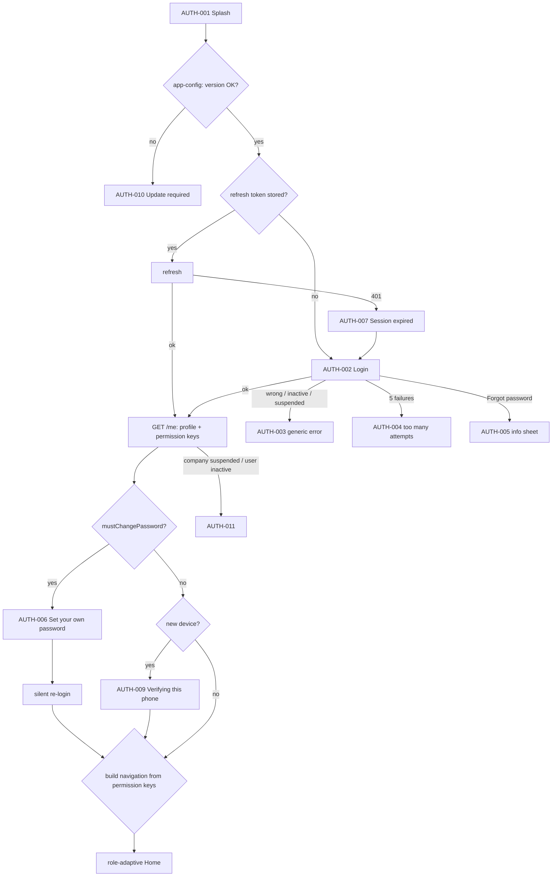

# Authentication flow

Screens: AUTH-001 … AUTH-011. Backend: thin bearer adapter over the existing `authenticateTenantUser()` and `requireSession()` checks (`docs/03_AUTHENTICATION_DESIGN.md`).

Rules: no company picker (email is unique across companies); the same lockout as web; logout (AUTH-008) revokes the server session; session messages use the server's text.
