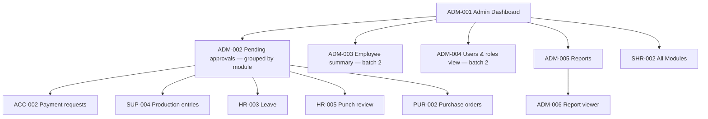

# Company admin flow

Screens: ADM-001 … ADM-006. In the ERP the company admin is `SUPER_ADMIN` (no separate "Company Admin" role); `MANAGEMENT` sees most of it read/approve.

Rules: financial cards only with finance/report permissions (an admin is not automatically a finance user); editing roles/permissions stays on the web (proposal, D-D07); company-wide counts and the cross-module approval total need new APIs (G-04, G-08).
