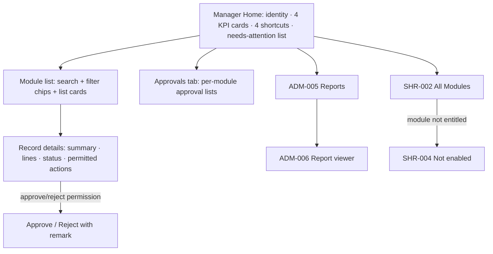

# Module manager flow (production, inventory, purchase, sales, accounts, HR, dispatch)

Each manager home (PM-001, INV-001, PUR-001, SAL-001, ACC-001, HR-001, DSP-001) follows one pattern, so all modules feel the same:

Rules
- A manager home exists per **permission set**, not per role name. A user with several (e.g. STORE_MANAGER = inventory + purchase) gets the home of their primary area and the rest under Modules.
- Actions inside a page follow action permissions (e.g. view PO but not approve).
- KPI values must come from existing reports; today they are pre-formatted strings → numeric KPI endpoint is a gap (G-03).
- Batch 1 designs the home + first list for each area; details/forms are batch 2 (see `ALL_SCREENS.md`).
