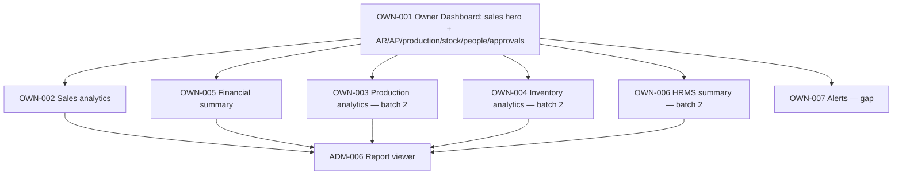

# Company owner flow

Screens: OWN-001 … OWN-007. There is no "Owner" role in the ERP — the owner dashboard is shown to users who hold the business-report permissions (`reports.view` + `financial_reports.view`), typically SUPER_ADMIN or MANAGEMENT.

Every number maps to an existing report (`dashboard/executive-dashboard`, `business-performance/*`, `receivables/*`, `payables/*`, `accounts/profit-and-loss`, `expenses/financial-accounts-balances`, `production/*`, `inventory/*`, `attendance/*`). Not available today: numeric KPI JSON (G-03), cash-flow trend, alert aggregation, SAM/efficiency %. Nothing is invented — those cards stay as gaps until approved.
