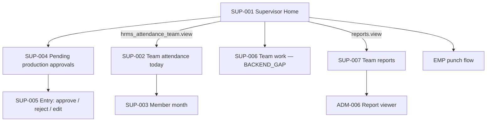

# Supervisor / team leader flow

Screens: SUP-001 … SUP-007 plus common employee screens. Bottom nav adds **Approvals**.

Important: by default `PRODUCTION_SUPERVISOR` has HRMS **self-service only** — no team attendance or HR approvals. Those cards appear only if the company grants `hrms_attendance_team.view` / approve permissions (decision D-D06). Production approvals are limited by branch, production stage and reporting team; nobody approves their own entry.
