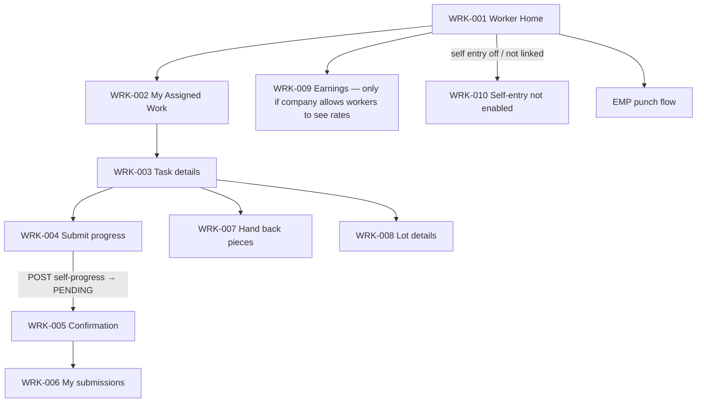

# Production worker flow

Screens: WRK-001 … WRK-010 plus all common employee screens. Data scope: only the worker's own assignments (existing `production-scope.ts`), self entry only if `Employee.selfEntryEnabled`.

The worker never sees create/approve production actions, other workers' entries, or job orders not assigned to them. Approval results currently create no notification (gap G-11) — WRK-006 shows the status.
