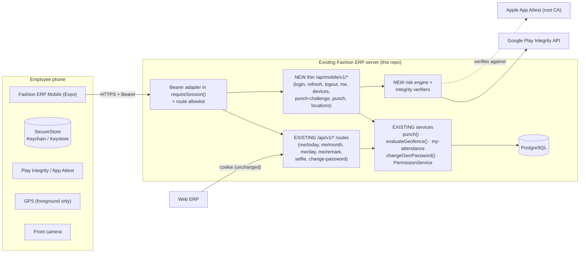

# 00 — Fashion ERP Mobile App: Project Overview

> **Status: DOCUMENTATION ONLY — waiting for the user's review and explicit approval.** No app code, no backend change, no migration exists. Every decision is **PROPOSED** until the user approves it in `12_DECISION_LOG.md`. Revision 2 (2026-11-03) incorporates the "Master Project Blueprint" prompt.

## 1. What we are building

One React Native (Expo, TypeScript) app for **Android and iOS**, for employees of companies using the Fashion ERP. It uses the **existing** Fashion ERP backend (Next.js 16, Prisma 7, PostgreSQL in this repository) as the single source of truth. There is no separate database, no second auth system and no second attendance engine.

**Version 1 contains only:**

| # | Area | Summary |
|---|---|---|
| 1 | Authentication | Email + existing ERP password (`authenticateTenantUser()`), company derived from the user (email is globally unique), access + rotating refresh tokens through a **thin bearer adapter** on the existing `requireSession()` checks, logout, expiry, deactivation, temporary-password and password-change handling, existing lockout |
| 2 | Attendance | Dashboard, check-in, check-out, history (month/day), remarks — all through existing services (`punch()`, `getMyAttendanceToday()`, `getMyMonthReport()`, `getMyDay()`, `setMyDayRemark()`); geofence decided only by the server's `evaluateGeofence()`; foreground location only |
| 3 | Anti-fake attendance | Server-issued punch challenge, idempotency, Play Integrity (Android) / App Attest (iOS) verified on the server, client device signals treated as **untrusted risk indicators**, a configurable, explainable server-side risk engine (NORMAL / SUSPICIOUS / HIGH_RISK) that routes suspicious punches into the **existing outdoor approval workflow** |

**Out of scope for v1:** production, leave, CRM, inventory, purchase, sales, dispatch, accounts, reports, notifications, regularization, team views, maps, offline punching, background tracking. Future modules: architecture only (`02` §8).

## 2. Big picture

## 3. Ground rules

1. Web behaviour does not change: NextAuth cookie login, `/api/v1/*` responses and attendance rules stay as they are. The adapter only adds a second way to identify the caller.
2. No duplicated logic: existing routes are reused where they exist; new routes call existing services.
3. The server decides time, geofence, duplicates, permissions and risk. Client-reported values (GPS, accuracy, "mock location = false", developer options…) are never trusted on their own.
4. No single weak signal marks an employee as fraudulent. Outcomes are explainable and configurable per company.
5. Genuine employees with weak indoor GPS must have an approved fallback before thresholds are tightened (factory test first, `04` §6).
6. One phase at a time, each with a user review gate (`11`, `13`).

## 4. Document map

| File | Content |
|---|---|
| `01_EXISTING_ERP_AUDIT.md` | Repo audit with labels, API classification, security weaknesses |
| `02_MOBILE_APP_ARCHITECTURE.md` | Stack evaluation, folders, layers, future modules |
| `03_AUTHENTICATION_DESIGN.md` | Bearer adapter, tokens, device registration, flows |
| `04_ATTENDANCE_DESIGN.md` | Dashboard, check-in/out, location handling, geofence, factory-floor issue, face |
| `05_API_CONTRACT.md` | Reused and new endpoints, payloads, errors |
| `06_DATABASE_AND_BACKEND_CHANGES.md` | Every proposed table/column/index with its reason |
| `07_UI_UX_SPECIFICATION.md` | 9 screens, states, copy |
| `08_SECURITY_AND_PRIVACY.md` | Threat model, anti-spoofing feasibility (Android/iOS), integrity, risk engine, face analysis, privacy |
| `09_TESTING_STRATEGY.md` | Auth / attendance / anti-fraud / platform test cases |
| `10_BUILD_AND_DEPLOYMENT.md` | Environments, EAS, accounts, costs, release order |
| `11_IMPLEMENTATION_ROADMAP.md` | Phases 0–8 |
| `12_DECISION_LOG.md` | Decisions (all PROPOSED) and open questions |
| `13_AI_AGENT_WORKFLOW.md` | Rules and handoff format for Codex / Claude Code / Antigravity |
| `14_MOBILE_PROJECT_STATUS.md` | Live status |

## 5. Labels

**EXISTING AND REUSABLE** · **REQUIRES ADAPTATION** · **MISSING** · **UNKNOWN** (not verifiable from the repo) · **SECURITY WEAKNESS** · decisions: **PROPOSED** / **APPROVED (date)**.
