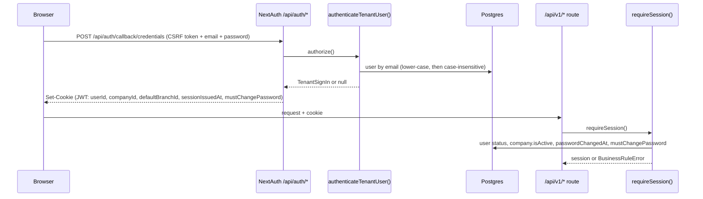
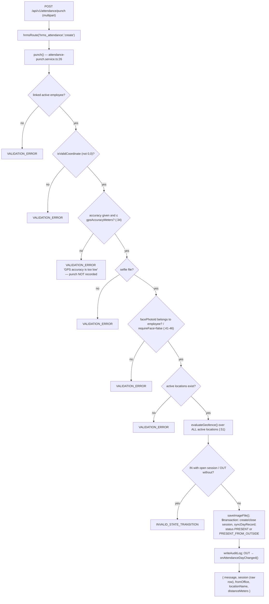

# 01 — Existing ERP Audit (read-only)

Audit date: 2026-11-03 (revision 2, after the master blueprint prompt). Base commit `fa45e745` on `main`. Nothing was changed while auditing. Line numbers are as of that commit.

**Labels:** **EXISTING AND REUSABLE** · **REQUIRES ADAPTATION** · **MISSING** · **UNKNOWN** · **SECURITY WEAKNESS** (SW-n, collected in §9).

> **Correction to earlier briefs:** the web login does **not** use database sessions. NextAuth runs with `session: { strategy: "jwt" }` (`fashion-erp/src/core/auth/auth.config.ts:21`): a signed JWT in an httpOnly cookie with the NextAuth default 30-day life (no `maxAge` set). The database is re-checked on every API call inside `requireSession()` instead.

## 1. Stack and project shape

| Item | Finding | Label |
|---|---|---|
| Framework | `next` 16.3.1, `react` 19.2.8, TypeScript 5 (`fashion-erp/package.json`) | EXISTING AND REUSABLE |
| DB / ORM | PostgreSQL, `prisma` + `@prisma/client` ^7.9.1 with `@prisma/adapter-pg`; one schema file `fashion-erp/prisma/schema.prisma` | EXISTING AND REUSABLE |
| Auth library | `next-auth` 5.0.0-beta.32, three Credentials providers (`fashion-erp/src/core/auth/auth.ts`): tenant `credentials`, `platform-credentials`, `support-session` | EXISTING |
| Validation | `zod` ^4.4.3, `*.schema.ts` per module | EXISTING AND REUSABLE |
| Face recognition | `@vladmandic/face-api` 1.7.15 used in the browser; models in `fashion-erp/public/models/face-api/` | EXISTING (web only) |
| Map | `leaflet` 1.9.4 + OSM tiles | EXISTING (web only) |
| Jobs | `bullmq` + `ioredis`, worker `fashion-erp/src/core/jobs/worker.ts` | EXISTING AND REUSABLE |
| Logging | `fashion-erp/src/core/logging/logger.ts`, `requestContext.ts` (correlation id + actor) | EXISTING AND REUSABLE |
| Audit | `writeAuditLog()` `fashion-erp/src/core/audit/AuditLogger.ts:29` (accepts a `tx`) | EXISTING AND REUSABLE |
| Tests | `vitest` 4 (`fashion-erp/vitest.config.mts`, node env) | EXISTING |
| Layout | pages `fashion-erp/src/app/(dashboard|auth|platform)/…`, API `fashion-erp/src/app/api/v1/**`, modules `fashion-erp/src/modules/<module>/`, shared `fashion-erp/src/core/` | EXISTING |
| Root tooling scope | `fashion-erp/tsconfig.json` includes `**/*.ts(x)` and excludes only `node_modules`, `.claude`; `fashion-erp/eslint.config.mjs` ignores only `.next/ out/ build/ next-env.d.ts`; `fashion-erp/vitest.config.mts` excludes `.claude`, `node_modules`, `dist`, `.next` | **Not needed any more** — the app lives in its own repository (`fashion-erp-mobile`, D-002 APPROVED), so the web `tsc`/`eslint`/`vitest` never see it. B-16 dropped. |
| Mobile code | none (no Expo / React Native packages) | MISSING |
| Deployment | `fashion-erp/Dockerfile`, `fashion-erp/docker-compose.yml` (`NEXTAUTH_URL`, `AUTH_TRUST_HOST`), `fashion-erp/Jenkinsfile`, `fashion-erp/docs/PLATFORM_SAAS_RUNBOOK.md`, `fashion-erp/docs/DEPLOYMENT_MIGRATIONS.md` | EXISTING |
| Production URL | `https://erp.indradhar.in/` (given by the user 2026-11-03). Checked: `GET /api/v1/health` → `{"status":"ok","database":"ok"}`; HTTPS with `Strict-Transport-Security: max-age=63072000; includeSubDomains`; served through **nginx 1.26.3** | EXISTING |
| Staging URL, single SaaS host for all companies vs per-customer install, number of app instances behind nginx | not in the repo | **UNKNOWN** (Q-09) |
| nginx in front | must pass the `Authorization` header (default unless overridden) and the real client IP (`X-Forwarded-For` / `X-Real-IP`) for the per-IP login limit (B-11); nginx config is not in the repo | **UNKNOWN** — check in Phase 1 |

## 2. Data model

| Model (`fashion-erp/prisma/schema.prisma`) | Fields that matter for mobile | Label |
|---|---|---|
| `Company` `:17` | `id`, `name`, `isActive`, `suspendedAt` | EXISTING AND REUSABLE |
| `User` `:872` | `companyId`, `email` **`@unique` across all companies** `:885`, `passwordHash`, `fullName`, `phone`, `employeeId @unique`, `status` (`ACTIVE / SUSPENDED / LOCKED`), `passwordChangedAt`, `mustChangePassword`, `supportForPlatformUserId`, `lastLoginAt`, `mfaSecret` (unused) | EXISTING AND REUSABLE — no company picker needed |
| `Employee` `:1614` | `employeeCode`, `fullName`, `branchId`, `departmentId`, `designationId`, `shiftId`, `isActive`, `deletedAt` | EXISTING AND REUSABLE |
| `ShiftMaster` `:2759` | `startTime`, `endTime` (`HH:mm`), `graceMinutes` | EXISTING AND REUSABLE |
| `AttendanceSettings` `:3885` (`hrms_attendance_settings`) | `gpsAccuracyMeters` default **50**, `maxSessionHours` 18, `statusToleranceMinutes` 15, `faceMatchThreshold` 0.45, `faceMatchFrames` 3, `requireFace` **true**, `defaultWeekends` | EXISTING (values configured in production: UNKNOWN; the dev DB was set to 150 m per the parent session — not re-verified) |
| `AttendanceLocation` `:3906` | `latitude`, `longitude`, `radiusMeters` default **100**, optional `branchId` (plain id, no FK), `isActive`; many per company | EXISTING AND REUSABLE |
| `AttendanceRecord` `:3642` | one per employee per IST date; `punchIn/punchOut`, `employeeRemark` | EXISTING |
| `AttendanceSession` `:3967` | `checkInAt/checkOutAt`, `status` (`PRESENT / PRESENT_FROM_OUTSIDE / REMOTE`), `source` (`SELF_PUNCH / MANUAL / REGULARIZATION`), in/out lat, lng, accuracy, address, locationId, distance, selfie key, facePhotoId | EXISTING |
| Open-session guard | partial unique index `hrms_attendance_sessions_one_open_self_punch` (`employee_id WHERE check_out_at IS NULL AND source = 'SELF_PUNCH'`) + CHECK out > in — `fashion-erp/prisma/migrations/20261023100000_attendance_module_port/migration.sql:400` | EXISTING AND REUSABLE |
| `EmployeeFacePhoto` `:3947` | image files only, max 3 (`MAX_FACE_PHOTOS`, `fashion-erp/src/modules/hrms/face-enrolment.service.ts:11`); **no stored face descriptors** | EXISTING |
| `OutdoorRejection` `:4043` | manager rejection of an outside punch; trims times; employee clarification + proof | EXISTING AND REUSABLE (review path for flagged punches) |
| Employee ↔ allowed office link | none — `punch()` checks **every** active company location; `AttendanceLocation.branchId` is not compared with `Employee.branchId` | **MISSING** (Q-19) |
| Mobile sessions / devices / refresh tokens | none (only `SupportAccessSession`, `CrmApiKey`) | MISSING (B-01, B-02) |
| Punch idempotency key / channel / device / integrity / risk data | none | MISSING (B-06) |

## 3. Authentication

| Item | Reference | Label |
|---|---|---|
| Credential check | `authenticateTenantUser()` `fashion-erp/src/core/auth/authenticate.ts:38`: normalises email, lockout, refuses non-ACTIVE user, inactive company, support proxy user; bcrypt verify (`fashion-erp/src/core/auth/password.ts`); stamps `lastLoginAt`; returns `null` for every failure | **EXISTING AND REUSABLE** — the mobile login adapter calls it unchanged |
| Lockout | `fashion-erp/src/core/auth/rateLimiter.ts`: 5 failures → 15 min, **in-memory LRU**, per process | EXISTING; **SW-3** on multi-instance/restart |
| Web session token | NextAuth JWT cookie, `sessionIssuedAt` stamped at sign-in (`auth.config.ts:57`) | EXISTING — **not usable from React Native** without imitating the browser CSRF/cookie flow (rejected, D-003) |
| Live checks | `requireSession()` `fashion-erp/src/lib/api-route.ts:42`: refuses PLATFORM; live SUPPORT check; user ACTIVE; company active (`ACCOUNT_SUSPENDED`); `sessionIssuedAt < passwordChangedAt` → denied; `mustChangePassword` → `PASSWORD_CHANGE_REQUIRED` unless `allowPendingPasswordChange`; `setRequestActor()` | **REQUIRES ADAPTATION** — reads identity only from NextAuth `auth()` (cookie). The bearer adapter plugs in here (D-003). |
| Unauthenticated response | "Sign in required." → `PERMISSION_DENIED` **403** | REQUIRES ADAPTATION for bearer clients (they need 401 to know when to refresh, D-019); web unchanged |
| Proxy | `fashion-erp/src/proxy.ts` (Next 16 proxy, Node runtime); matcher includes `/api/*` except `/api/auth`; API requests without a cookie session pass through (`return true`) | EXISTING; REQUIRES ADAPTATION only to enforce the bearer route allowlist (B-04) |
| User bearer / refresh tokens | none (`Bearer` appears only for CRM API keys and AI providers) | MISSING |
| Hashing patterns | SHA-256 + `timingSafeEqual` in `fashion-erp/src/modules/crm/capture/crm-api-keys.service.ts`; one-time exchange tokens in `fashion-erp/src/core/support-access/codes.ts` | EXISTING AND REUSABLE (pattern) |
| Change own password | `POST /api/v1/account/change-password` (`fashion-erp/src/app/api/v1/account/change-password/route.ts`) → `changeOwnPassword()` `fashion-erp/src/modules/account/account.service.ts:22`; rules: current password correct, ≥ 8 chars, not the temporary password, not the same; stamps `passwordChangedAt`; clears `mustChangePassword`; audit | **EXISTING AND REUSABLE** via the bearer adapter (route allowed while `mustChangePassword`) |
| Temporary password | logins created from Employee Master get the fixed temporary password from `fashion-erp/src/modules/administration/temporary-password.ts:8` (`user-admin.service.ts:132`) with `mustChangePassword = true` | EXISTING; **SW-6** |
| Forgot password (self-service) | none; admin reset `resetUserPassword()` `user-admin.service.ts:373`, platform reset routes | MISSING (out of v1, Q-05) |
| 2FA | `User.mfaSecret` unused | MISSING (deferred) |
| Env | `NEXTAUTH_SECRET`/`AUTH_SECRET`, `NEXTAUTH_URL`, `DATABASE_URL`, `FILE_STORAGE_ROOT`, `REDIS_URL`; no `.env.example` tracked | EXISTING; mobile env vars MISSING |

## 4. RBAC, entitlements, scope

| Item | Reference | Label |
|---|---|---|
| Permission engine | `PermissionService.can/assert/getViewableModules` `fashion-erp/src/core/rbac/PermissionService.ts` (globalThis singleton). `evaluate()` reloads live user state, returns `MODULE_NOT_ENABLED` for disabled packages, `SUBSCRIPTION_READ_ONLY` for non-read actions after expiry, self-approval guard | **EXISTING AND REUSABLE** — needs only a `userId`, so bearer requests work unchanged |
| Modules | `fashion-erp/src/config/rbac.ts`: `hrms_attendance` = My Attendance (punch + own records). `HRMS_SELF_SERVICE` (`:188`) gives internal roles `hrms_attendance: view, create` | EXISTING AND REUSABLE |
| Entitlements | `fashion-erp/src/config/module-entitlements.ts` package `HRMS` (`:75`) | EXISTING AND REUSABLE |
| HRMS team scope | `fashion-erp/src/modules/hrms/hrms-scope.ts` (self + reporting team, `view_all`) | EXISTING (self-only use in v1) |
| Route wrapper | `hrmsRoute()` `fashion-erp/src/modules/hrms/hrms-route.ts`: `requireSession()` → any-of permission → handler → `{ data }` | **EXISTING AND REUSABLE** — once `requireSession()` accepts a mobile bearer token, every `hrmsRoute` route works for mobile with no route change |
| Mobile-specific permission | none | UNKNOWN whether wanted (Q-10) |
| "My permissions/profile" endpoint | none for tenant users | MISSING (`GET /api/mobile/v1/me`) |

## 5. Attendance

| Item | Reference | Label |
|---|---|---|
| Punch service | `punch(actor, input, now)` `fashion-erp/src/modules/hrms/attendance-punch.service.ts:26` — transport-free, takes `{ companyId, userId }` | **EXISTING AND REUSABLE**; REQUIRES ADAPTATION (small optional `options` param) to write mobile metadata in the same transaction and to force review status (B-19) |
| Server time | `now = new Date()` server-side | EXISTING AND REUSABLE |
| Accuracy rule | `:34` reject if `accuracy` missing or `> gpsAccuracyMeters`; the reading is **client-reported** | EXISTING; **SW-2** |
| Geofence | `evaluateGeofence()` `fashion-erp/src/modules/hrms/attendance-calculator.ts:281` — Haversine (`:256`), `effectiveRadius()` (`:265`) = max(10, radius) or 100, nearest inside else nearest overall, distance rounded | **EXISTING AND REUSABLE** — the server is the only place it runs for a decision |
| Outside punch | recorded as `PRESENT_FROM_OUTSIDE`; manager approves (→ `REMOTE`, `outdoor-attendance.service.ts:86`) or rejects (`OutdoorRejection`, times trimmed); employee may clarify with proof | **EXISTING AND REUSABLE** as the review path for SUSPICIOUS mobile punches (D-011) |
| Duplicates | pre-check + re-read in transaction + guarded `updateMany` + partial unique index; P2002 → "already logged in" (`:153`) | EXISTING AND REUSABLE; REQUIRES ADAPTATION for network retries (no idempotency key — **SW-5**) |
| Face verification | browser: `FacePunchCamera.tsx` loads face-api models (`:24-26`), `FaceMatcher(threshold)` over `frames` frames, then sends `facePhotoId`. Server only checks the photo id belongs to the employee (`attendance-punch.service.ts:41-46`); if `requireFace` and no id → rejected | EXISTING (web); **SW-1** |
| Selfie storage | `saveImageFile()` `attendance-session.core.ts:72`: JPG/PNG/WEBP, ≤ 5 MB (`:69`), `FileStorage.saveFile()` with magic-byte check (`fashion-erp/src/core/file-storage/FileStorage.ts:129`), private root `FILE_STORAGE_ROOT ?? ./uploads` | EXISTING AND REUSABLE |
| Punch response | returns the raw `AttendanceSession` row (incl. `inSelfieKey/outSelfieKey` storage keys) | EXISTING; **SW-4** (minor) |
| Today | `getMyAttendanceToday()` (in `attendance-punch.service.ts`) | EXISTING AND REUSABLE |
| Month / day / remark | `getMyMonthReport()`, `getMyDay()`, `setMyDayRemark()` (`fashion-erp/src/modules/hrms/my-attendance.service.ts`); remark schema `dayRemarkSchema` (`my-attendance.schema.ts`, max 500) | EXISTING AND REUSABLE |
| Selfie / face file readers | `readSessionSelfie()` (scope-checked, `face-enrolment.service.ts:82`), `readFacePhoto()` | EXISTING AND REUSABLE |
| Office list readable by employees | `GET /api/v1/attendance/locations` needs `hrms_attendance_settings.view` | MISSING for employees (new projected mobile route) |
| Shift rule at punch | none; lateness computed later by `computeIsLateIst()` (`attendance-calculator.ts:241`) | EXISTING behaviour (kept) |
| Weak-GPS fallback for genuine employees | punch is rejected (not recorded). Existing after-the-fact path: attendance correction / regularization (`hrms_attendance_regularization`, `attendance-correction.service.ts`) on the web | EXISTING but web-only; v1 mobile shows the path, does not implement it (Q-13) |
| Mock-location / device integrity / attestation | none anywhere | MISSING |
| Offline punching | none (and not wanted) | n/a |

## 6. Existing API classification

Only routes that matter for mobile v1. Methods and paths verified from `fashion-erp/src/app/api/**/route.ts`. "Adapter" = the bearer adapter in `requireSession()` (D-003).

| # | Existing route | Method | Auth / permission today | Payload → response | Classification | Notes |
|---|---|---|---|---|---|---|
| 1 | `/api/v1/health` | GET | none | → `{ status, database, timestamp }` | **REUSE AS IS** | connectivity check |
| 2 | `/api/auth/callback/credentials` (NextAuth) | POST | CSRF + form | → cookie | **NOT REUSED** (cookie/CSRF flow); its logic `authenticateTenantUser()` is reused by new `POST /api/mobile/v1/auth/login` | D-003 |
| 3 | `/api/v1/account/change-password` | POST | `requireSession({ allowPendingPasswordChange })` | `{ currentPassword, newPassword }` → `{ data: { ok: true } }` | **REUSE WITH MOBILE AUTH ADAPTER** | after success the app signs in again with the new password (old mobile session dies by the existing `passwordChangedAt` check) |
| 4 | `/api/v1/attendance/me/today` | GET | `hrmsRoute(hrms_attendance, view)` | → `getMyAttendanceToday()` | **REUSE WITH MOBILE AUTH ADAPTER** | |
| 5 | `/api/v1/attendance/me/month?month=YYYY-MM` | GET | `hrms_attendance.view` | → `getMyMonthReport()` | **REUSE WITH MOBILE AUTH ADAPTER** | |
| 6 | `/api/v1/attendance/me/day?date=YYYY-MM-DD` | GET | `hrms_attendance.view` | → `getMyDay()` | **REUSE WITH MOBILE AUTH ADAPTER** | |
| 7 | `/api/v1/attendance/me/remark` | PUT | `hrms_attendance.create` | `{ date, remark }` → `setMyDayRemark()` | **REUSE WITH MOBILE AUTH ADAPTER** | |
| 8 | `/api/v1/attendance/me/sessions?date|month` | GET | `hrms_attendance.view` | → `listSessions()` | **REUSE WITH MOBILE AUTH ADAPTER** (optional) | not needed by v1 screens |
| 9 | `/api/v1/attendance/sessions/[id]/selfie/[side]` | GET | any `view` of `hrms_attendance`, `_team`, `_photos`, `_outdoor` | → image bytes | **REUSE WITH MOBILE AUTH ADAPTER** | own selfies via HRMS scope |
| 10 | `/api/v1/attendance/face-photos/file/[photoId]` | GET | `hrms_attendance` or `_settings` view | → image bytes | **REUSE WITH MOBILE AUTH ADAPTER — only if on-device face matching is approved** | privacy (Q-01) |
| 11 | `/api/v1/attendance/punch` | POST | `hrms_attendance.create` | multipart → `punch()` raw result | **NOT REUSED BY MOBILE; service reused** — mobile punch needs a server challenge, integrity token, idempotency key, signals and risk evaluation, and must not return storage keys. A thin **NEW** `POST /api/mobile/v1/attendance/punch` calls the same `punch()` (+ **MINIMUM MODIFICATION**: optional `options` param, B-19) | D-030 |
| 12 | `/api/v1/attendance/locations` | GET | `hrms_attendance_settings.view` | → full rows incl. inactive | **NOT REUSED**; **NEW** projected `GET /api/mobile/v1/attendance/locations` (active only, name/lat/lng/radius) via `listAttendanceLocations()` | changing the web route's permission would widen web semantics |
| 13 | `/api/v1/attendance/outdoor` | GET/POST | `hrms_attendance_outdoor` approve/reject | web manager queue | **REUSE AS IS (web)** for reviewing SUSPICIOUS punches; **MINIMUM MODIFICATION** to show risk reasons (B-17) | |
| 14 | `/api/v1/attendance/settings` | GET/PUT | `hrms_attendance_settings` | settings | **MINIMUM MODIFICATION** (web) to edit new mobile policy fields (B-09) | |
| 15 | admin user status / password reset routes (`user-admin.service.ts` `setUserStatus()` `:333`, `resetUserPassword()` `:373`) | — | admin | — | **REUSE AS IS**; **MINIMUM MODIFICATION** to also revoke mobile sessions/devices (B-13) | live checks already block them |

**New APIs required** (no existing equivalent): `GET /api/mobile/v1/app-config`, `POST …/auth/login`, `POST …/auth/refresh`, `POST …/auth/logout`, `POST …/auth/logout-all`, `GET …/me`, `GET/DELETE …/devices`, `POST …/devices/register`, `POST …/attendance/punch-challenge`, `POST …/attendance/punch`, `GET …/attendance/locations`. Contracts: `05_API_CONTRACT.md`.

## 7. API conventions

| Item | Reference | Label |
|---|---|---|
| Success | `{ data }` | EXISTING AND REUSABLE |
| Error | `toErrorResponse()` `fashion-erp/src/core/errors/BusinessRuleError.ts:259` → `{ success: false, message, errors?, error: { code, message, details } }` | EXISTING AND REUSABLE |
| Codes | closed union + HTTP map in the same file; relevant: `PERMISSION_DENIED 403`, `ACCOUNT_SUSPENDED 403`, `PASSWORD_CHANGE_REQUIRED 403`, `MODULE_NOT_ENABLED 403`, `SUBSCRIPTION_READ_ONLY 403`, `VALIDATION_ERROR 400`, `INVALID_STATE_TRANSITION 409`, `RATE_LIMITED 429`, `PAYLOAD_TOO_LARGE 413`, `NOT_FOUND 404` | EXISTING; mobile token/integrity codes MISSING (B-10) |
| CORS | none | not needed (native apps are not subject to CORS) |
| Correlation | `initRequestContext()` / `setRequestActor()` | EXISTING AND REUSABLE |

## 8. Security headers (`fashion-erp/next.config.ts`)

CSP (incl. OSM tiles), `Permissions-Policy: camera=(self), microphone=(self), geolocation=(self)` (`:80`), HSTS 2 years, `X-Frame-Options: DENY`. All browser-only; **no effect on a native app**. HSTS implies production is HTTPS. `allowedDevOrigins: ["192.168.29.215"]` (`:37`) lets LAN devices reach the dev server.

## 9. Security weaknesses found

| Id | Weakness | Where | Impact on mobile | Handling |
|---|---|---|---|---|
| SW-1 | Face matching runs only in the browser; server trusts the client's `facePhotoId` | `attendance-punch.service.ts:41-46`, `FacePunchCamera.tsx` | copying this model to mobile gives no real face assurance | do not copy blindly; decision Q-01 / D-012 |
| SW-2 | Coordinates and `accuracy` are client-reported; a modified client can send any point with accuracy 5 m | `punch/route.ts`, `punch()` `:34` | GPS alone can't prove presence | integrity attestation + server signals + risk engine (`08` §4–6) |
| SW-3 | Login lockout is in-memory per process; resets on restart; not shared across instances | `rateLimiter.ts` | weaker brute-force protection | add per-IP limit (B-11); Redis limiter if multi-instance (Q-09) |
| SW-4 | Punch response returns raw session incl. selfie storage keys | `punch()` return | info exposure | mobile route returns `toMySessionView()` shape |
| SW-5 | No idempotency on punch → retry of a saved punch returns a misleading error | `punch()` | bad UX on mobile networks | `clientPunchId` (D-010) |
| SW-6 | Every Employee-Master login starts with the same fixed temporary password until first sign-in | `temporary-password.ts:8`, `user-admin.service.ts:132` | anyone who knows a new employee's email can sign in first (mobile or web) and set the password | out of mobile scope; report to user; mitigations: random temp passwords / admin-shared — follow-up (Q-21) |

## 10. Tests that protect reused code (must stay green unchanged)

`fashion-erp/src/core/auth/authenticate.test.ts`, `rateLimiter.test.ts`, `route-access.test.ts`; `fashion-erp/src/lib/api-route.test.ts` (requireSession); `fashion-erp/src/core/rbac/PermissionService.test.ts`, `PermissionService.support.test.ts`; `fashion-erp/src/modules/hrms/attendance-punch.service.test.ts`, `attendance-calculator.test.ts`, `my-attendance.service.test.ts`, `attendance-settings.service.test.ts`, `outdoor-attendance.service.test.ts`, `attendance.integration.test.ts` (needs `HRMS_IT_DATABASE_URL`); `fashion-erp/src/modules/account/account.service.test.ts`.

## 11. Agent instruction conflict

Root `fashion-erp/AGENTS.md` and `fashion-erp/GEMINI.md` say "never ask clarification questions" and "do not ask for confirmation or approval". This conflicts with the documentation-first, approval-gated process the user requires for the mobile project. Per the user's rule, agents must **stop and report** this conflict rather than silently override it. Reported to the user as **Q-17**; see `13_AI_AGENT_WORKFLOW.md` §1.
