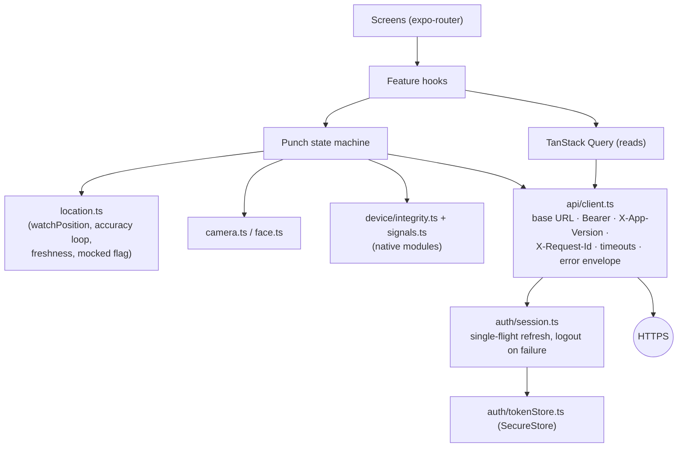
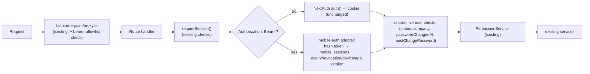
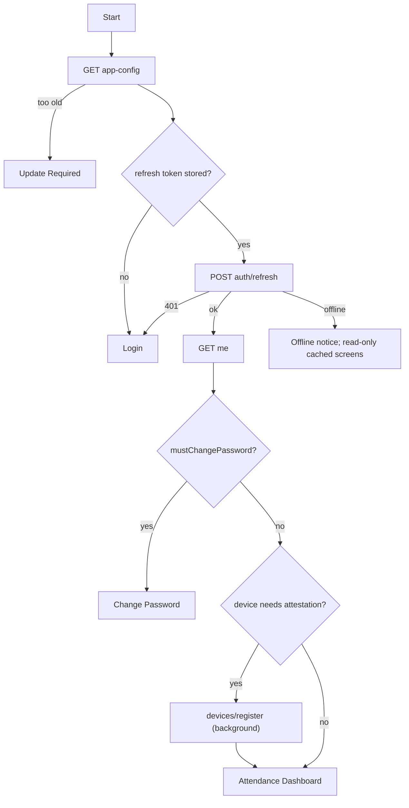
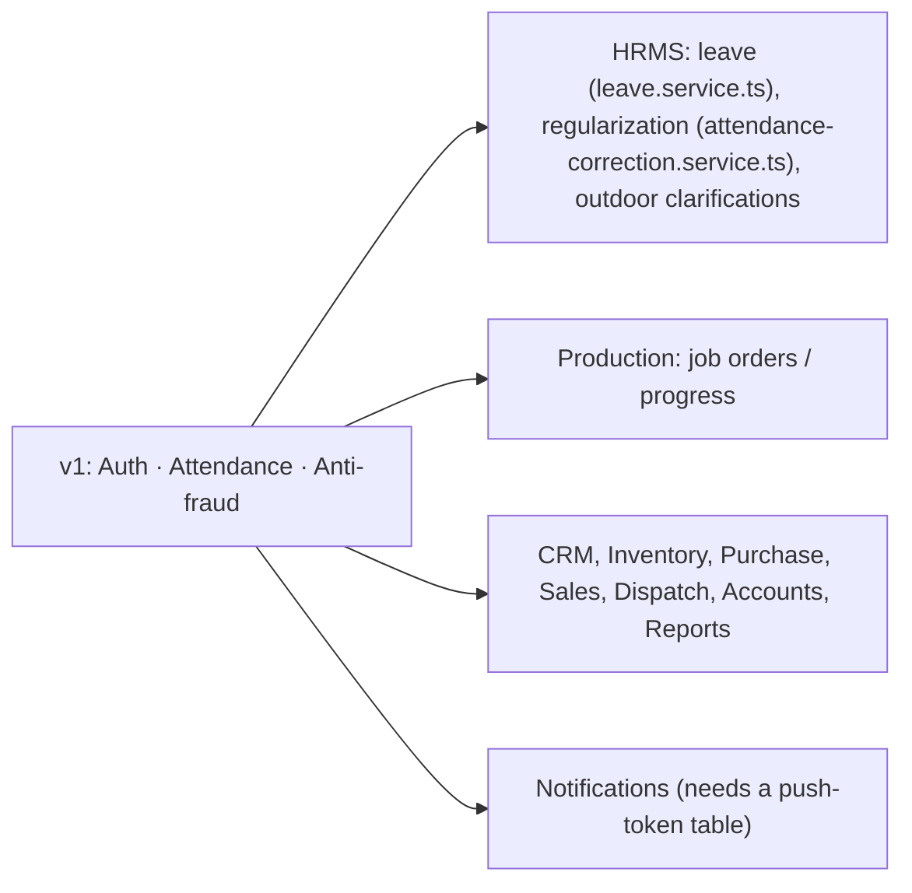

# 02 — Mobile App Architecture (PROPOSED)

## 1. Technology evaluation (D-001)

| Option | For | Against | Verdict |
|---|---|---|---|
| **React Native + Expo** (dev builds / `expo prebuild`, EAS) | TypeScript + React like the web; first-party `expo-location`, `expo-camera`, `expo-secure-store`, `expo-image-manipulator`, `expo-router`; custom native code possible through the Expo Modules API + config plugins (needed for Play Integrity, App Attest, Android settings signals) | Integrity/attestation and some device signals need native modules → **Expo Go cannot be used**, only development builds | **Recommended** |
| Bare React Native | full native control | more upkeep; Expo dev builds already allow native modules | not needed |
| Flutter | performance | Dart; no reuse of team skills | rejected |
| Native Kotlin + Swift | best device access | two codebases | rejected |
| PWA (improve the web page) | no install | no integrity attestation, no mock-location signal, weaker iOS | rejected |

### Dependency compatibility (to confirm in Phase 0 against the Expo SDK chosen, D-023)

| Need | Candidate | Status |
|---|---|---|
| Routing | `expo-router` | first-party |
| Location | `expo-location` (`LocationObject.mocked` on **Android and iOS**, `timestamp`, `accuracy`; permission `android.accuracy` fine/coarse, `ios.accuracy` full/reduced) | first-party — Spike B confirmed from docs (D-034) |
| Camera | `expo-camera` | first-party |
| Tokens | `expo-secure-store` | first-party |
| Image resize | `expo-image-manipulator` | first-party |
| Network state | `@react-native-community/netinfo` | community, Expo-supported |
| Server state | `@tanstack/react-query` | pure JS |
| Validation | `zod` v4 | pure JS |
| Play Integrity (Android) | **`@expo/app-integrity`** (official Expo, alpha since SDK 54): `prepareIntegrityTokenProviderAsync`, `requestIntegrityCheckAsync(requestHash)` | PROPOSED D-033; pin version, wrap in `src/device/integrity.ts`; fallback custom Expo Module |
| App Attest (iOS) | **`@expo/app-integrity`**: `isSupported`, `generateKeyAsync`, `attestKeyAsync`, `generateAssertionAsync` | PROPOSED D-033 (see `docs/spikes/integrity.md`) |
| Android settings signals (developer options, ADB) | custom Expo Module (`Settings.Global`) | needs native code |
| Face capture/match | open (Q-01) | Spike A |
| Tests | `jest-expo`, React Native Testing Library, Maestro | standard |

Rule: no package is added without a line in the decision log (D-031).

## 2. Repository placement (D-002)

Two repositories (D-002 **APPROVED 2026-11-03** — the user decided the app must not live in the ERP repo):

- **`fashion-erp`** (existing, GitHub `TeamsIndradhar/fashion-erp`): backend changes only — `src/modules/mobile-auth`, `src/modules/mobile-attendance`, `src/app/api/mobile/v1`, migrations.
- **`fashion-erp-mobile`** (new, local folder `D:\office-data\claude-projects\fashion-erp-mobile`; no GitHub remote yet): the app and these docs.

In these docs, paths starting with `fashion-erp/` are in the ERP repo; all other paths are in this repo.

```
fashion-erp-mobile/
    ├── docs/                  these documents (+ spikes/)
    ├── app/                   expo-router screens: (auth)/login, (auth)/change-password, (app)/index (dashboard),
    │                          (app)/punch, (app)/history, (app)/day/[date], (app)/profile, permission, gps-check, security-warning, update-required
    ├── modules/               local Expo Modules (native): device-integrity (Play Integrity / App Attest), device-signals
    ├── src/
    │   ├── api/               client.ts, endpoints, types.ts (hand-written from 05), __fixtures__ (from server contract tests)
    │   ├── auth/              tokenStore.ts, session.ts (single-flight refresh), AuthProvider
    │   ├── device/            installationId.ts, integrity.ts, signals.ts
    │   ├── features/attendance/  queries, punchMachine.ts, location.ts, camera.ts, face.ts, estimate.ts (Haversine, display only)
    │   ├── features/profile/
    │   ├── components/  theme/  config/ (env, strings)  lib/ (IST dates, logger)
    ├── app.config.ts  eas.json  package.json  tsconfig.json
```

Because the app is a separate repository, the web build/lint/test configuration is untouched (B-16 dropped). The app never imports ERP code; API types are hand-written from `05` (D-013).

## 3. Layers



| Concern | Choice |
|---|---|
| Navigation | `expo-router`; groups `(auth)` and `(app)`; redirect by auth state |
| State | TanStack Query for server data; React context for auth; `useReducer` state machine for punch |
| HTTP | `fetch` wrapper; multipart via `FormData { uri, name, type }`; 15 s JSON timeout, 45 s punch |
| Storage | SecureStore for tokens + installation id only; nothing else persisted except non-sensitive UI prefs |
| Dates | display IST like the web |
| Strings | one `strings.ts` (English v1, Hindi-ready, Q-11) |
| Logging | dev console; crash vendor undecided (Q-12) |

## 4. Server-side shape



## 5. App start



## 6. Networking rules

- Base URL is build-time `EXPO_PUBLIC_API_BASE_URL` — one SaaS host — or a "server address" screen if customers self-host (Q-09).
- `401 AUTH_TOKEN_EXPIRED` → single refresh then one replay; other 401s → Login.
- `403 PASSWORD_CHANGE_REQUIRED` → change-password; `ACCOUNT_SUSPENDED`, `MODULE_NOT_ENABLED`, `DEVICE_NOT_ALLOWED` → explanation screens.
- Punch retries always reuse the same `clientPunchId`. The server looks the id up **before** checking the challenge, so a punch that was already saved is replayed even if its challenge has expired; if it was never saved, the app fetches a fresh challenge (and a fresh GPS fix) and sends it with the same `clientPunchId` (`04` §8).

## 7. What runs where

| Logic | Client | Server |
|---|---|---|
| GPS acquisition, accuracy loop, freshness check | ✅ | — |
| Office distance **estimate** for display | ✅ (`estimate.ts`) | — |
| Geofence decision, status, hours | — | ✅ `evaluateGeofence()` / `punch()` |
| Collect device signals | ✅ | — |
| Verify integrity tokens / assertions | — | ✅ |
| Risk level and outcome | — | ✅ |
| Duplicate protection | button lock | ✅ idempotency + existing guards |

## 8. Future modules (architecture only)

New module = `src/features/<name>/` + screens + `/api/v1` reuse through the adapter (add routes to the allowlist) or a thin `/api/mobile/v1/<name>` route calling existing services. A tab appears only when `GET /me` reports `view` permission **and** the entitlement is on.



None of these are designed or built now.
