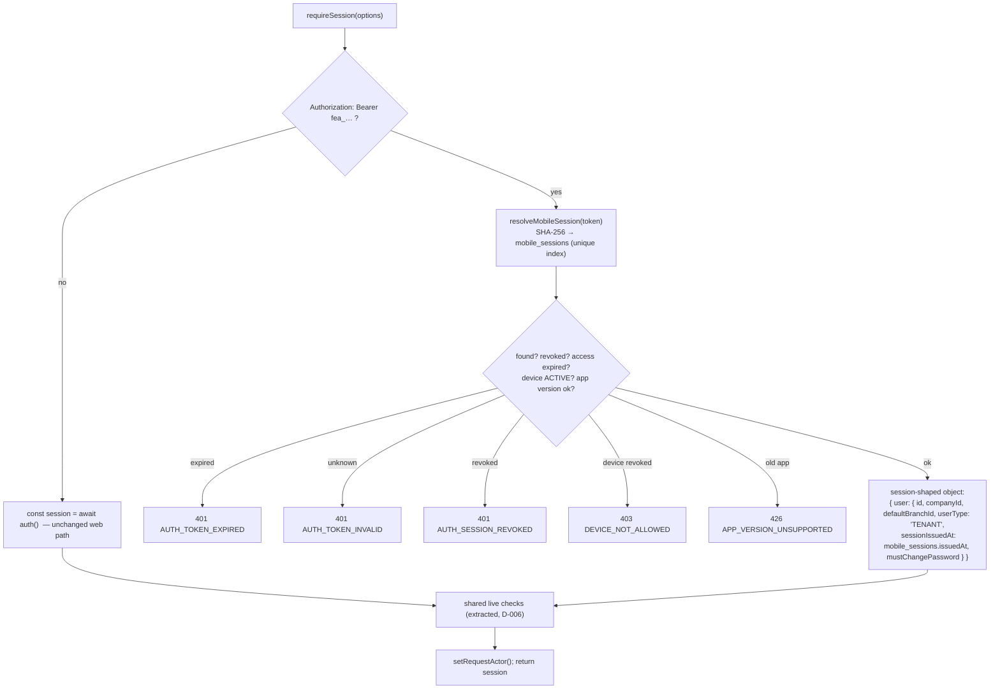
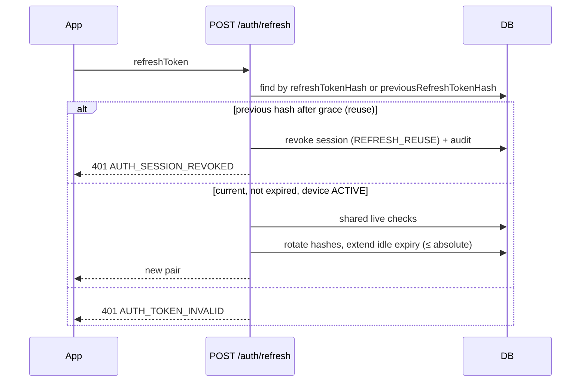

# 03 — Authentication Design (PROPOSED)

## 1. Goals

- Same email + password, same lockout and same refusal rules as the web — by calling `authenticateTenantUser()` (`fashion-erp/src/core/auth/authenticate.ts:38`) unchanged.
- Company context from the user row (`User.email` is unique across companies, `fashion-erp/prisma/schema.prisma:885`) — no company picker.
- Same live checks on every request as `requireSession()` (`fashion-erp/src/lib/api-route.ts:42`): user ACTIVE, company active, session not older than `passwordChangedAt`, temporary-password lock.
- **A thin adapter, not a second auth system.** No new password store, no new user table, no new permission engine.
- Web cookie login unchanged.

## 2. Why a bearer adapter (D-003)

| Option | Verdict |
|---|---|
| Use the NextAuth cookie from React Native (fetch `/api/auth/csrf`, post to `/api/auth/callback/credentials`, keep cookie jar) | **Rejected** — relies on NextAuth's browser flow (CSRF cookie, redirects), cookies stored in the OS HTTP cookie jar instead of Keychain/Keystore, no per-device revocation (stateless JWT, 30 days), cannot tell phone from browser |
| Fully separate mobile auth + all-new `/api/mobile/v1` copies of every route | **Rejected** — duplicates routes the web already has |
| **Bearer adapter inside `requireSession()` + route allowlist; existing `/api/v1` routes reused; new thin routes only for what doesn't exist** | **Recommended** |

### 2.1 The adapter



- The only change to `requireSession()` is: pick the identity source, then run the **same** checks. The checks are extracted into one function used by both paths, so they cannot drift. Acceptance: `fashion-erp/src/lib/api-route.test.ts` passes **without edits**.
- How the route handler reads the header (Next 16 `headers()` from `next/headers`, or passing the `Request`) must be confirmed against `node_modules/next/dist/docs/` in Phase 1 (repo `AGENTS` note: "This is NOT the Next.js you know").
- **Allowlist:** a bearer token is accepted only on routes listed in `05_API_CONTRACT.md` (§2 + §3). Enforcement in `fashion-erp/src/proxy.ts`, which already sees every `/api/*` request and its path: a request with a bearer header to a non-allowlisted path gets `403 PERMISSION_DENIED`. This keeps a stolen phone token from reaching the rest of the ERP API, even where the user's role would allow it (least privilege).
- If a request carries both a cookie and a bearer header, the bearer path is used.
- `hrmsRoute()` needs no change: it already gets `companyId`, `userId`, `defaultBranchId` from the session object.

## 3. Tokens (D-004) — values to validate before approval

| Item | Proposed | Validation notes |
|---|---|---|
| Access token | opaque 32 random bytes, base64url, prefix `fea_`, **15 min** | short because it is a bearer secret; every request already reads the DB for live checks, so opaque costs one indexed lookup and gives instant revocation; no JWT library or new signing secret |
| Refresh token | opaque 32 bytes, prefix `fer_`, **30 days idle (sliding)** | employees punch daily, so idle expiry rarely bites; 30 days covers leave |
| Max session | **90 days absolute** | forces a password re-entry each quarter; Q-04 |
| Rotation | new refresh token on every use; previous hash kept with a **30 s grace** for a lost response | reuse after grace → revoke session (`REFRESH_REUSE`), audit |
| Storage (server) | SHA-256 hashes only (pattern: `crm-api-keys.service.ts`), never raw | constant-time compare |
| Storage (phone) | `expo-secure-store`, `WHEN_UNLOCKED_THIS_DEVICE_ONLY` (not in backups, not migrated to a new phone) | D-014 |

## 4. Flows

### 4.1 Login

```mermaid
sequenceDiagram
  participant App
  participant L as POST /api/mobile/v1/auth/login
  participant AU as authenticateTenantUser() (existing)
  participant DS as mobile-auth service (new)
  participant DB
  App->>L: email, password, device{installationId, platform, model, osVersion, appVersion}
  L->>L: per-IP rate limit (new), app version check
  L->>AU: (email, password) — existing lockout + rules
  AU-->>L: TenantSignIn | null
  alt null
    L-->>App: 401 INVALID_LOGIN (generic text, as web)
  else ok
    L->>DS: upsertDevice(user, installationId) — apply device policy (Q-16)
    alt device revoked / limit reached / approval required
      L-->>App: 403 DEVICE_NOT_ALLOWED
    else
      DS->>DB: revoke older session on same device; insert mobile_sessions (hashes, expiries, issuedAt)
      DS->>DB: writeAuditLog(mobile_sessions, CREATE)
      L-->>App: tokens + user + company + mustChangePassword + device{status, needsAttestation}
    end
  end
```

No permission gate at login (Q-10); attendance permissions come from `GET /me`. Platform users (separate table) and support proxy users (refused in `authenticateTenantUser()`) can never sign in.

### 4.2 Refresh



The app refreshes single-flight. Refresh is rate-limited per session and IP.

### 4.3 Logout / revocation

| Trigger | Effect |
|---|---|
| `POST /auth/logout` | revoke this session; app wipes tokens even offline |
| `POST /auth/logout-all` | revoke all the user's mobile sessions |
| `DELETE /devices/{id}` | revoke device + its sessions |
| Password changed (any channel) | existing live check refuses every session issued earlier; rows marked revoked lazily on next use |
| Admin password reset / user suspended | existing live check refuses; plus B-13 marks sessions revoked immediately |
| Company suspended | existing `ACCOUNT_SUSPENDED` |

### 4.4 Expiry messages

| Case | Message |
|---|---|
| Access expired | silent refresh |
| Refresh idle/absolute expired | "Your session has expired. Please sign in again." |
| Revoked / reuse | "You were signed out on this device. Please sign in again." |
| Password changed | "Your password was changed. Please sign in again." (web text) |
| User inactive | "Your account is no longer active. Please sign in again." (web text) |
| Company suspended | "Your company's account is suspended. Please contact support." (web text) |
| Device revoked | "This phone is no longer allowed for attendance. Contact HR." |

### 4.5 Temporary password and password change

- Login succeeds with `mustChangePassword: true` (same as web); every other call returns `403 PASSWORD_CHANGE_REQUIRED` (existing behaviour of `requireSession()`), except `GET /api/mobile/v1/me` and `POST /api/v1/account/change-password`, which pass `allowPendingPasswordChange`.
- Change password uses the **existing** route and `changeOwnPassword()` (rules: correct current, ≥ 8 chars, not the temporary password, not the same).
- After success the app calls `auth/login` with the new password to obtain a fresh pair (its old session is now older than `passwordChangedAt`). **No server change needed.** Other devices are signed out by the same existing check.
- Security note SW-6 (fixed temporary password) is outside mobile scope but affects first sign-in on mobile too — Q-21.

### 4.6 Forgot password
Not available in the ERP. App text: "Ask your HR or admin to reset your password. You'll get a temporary password and must change it after signing in." (D-016, Q-05)

## 5. Device registration (D-024)

| Item | Proposal |
|---|---|
| Identifier | `installationId` = random UUID created on first launch, kept in SecureStore. Not IMEI, not advertising id, not hardware serial. Reinstall = new device. |
| Row | `mobile_devices` (company, user, installationId, platform, model, os/app version, status, integrity data — `06` §3) |
| Link to employee | through `User.employeeId` (no new employee column) |
| Policy (company setting, Q-16) | max active devices per user (proposed default **2**); optional "new device needs HR approval" (status `PENDING_APPROVAL`) for companies that want strict binding |
| Company-owned vs personal | both supported; optional `ownership` label set by HR (no technical difference in v1) |
| Shared device (one phone, many employees) | not supported in v1 (Q-07); a second employee signing in on the same installation creates a separate device row and is visible in risk signals ("device used by another employee today") |
| Replacement / lost device | user or HR revokes the old device (`DELETE /devices/{id}` / web admin later, B-20); logout-all; password change |
| Integrity | iOS: App Attest key registered on the device row; Android: Play Integrity verdict stored at registration and per punch |

## 6. Profile and RBAC

`GET /api/mobile/v1/me` returns user, company, employee (code, branch, department, designation, shift), `mustChangePassword`, `permissions.attendance { view: can(hrms_attendance, view), punch: can(hrms_attendance, create) }`, `modulesEnabled.hrms`, device status. The server enforces everything with `PermissionService`; the app only hides what isn't allowed. Users without attendance permission see "Attendance isn't enabled for your account".

## 7. Not in v1

2FA (`User.mfaSecret` unused), biometric unlock of the stored refresh token, SSO, self-service forgot password, profile editing.
