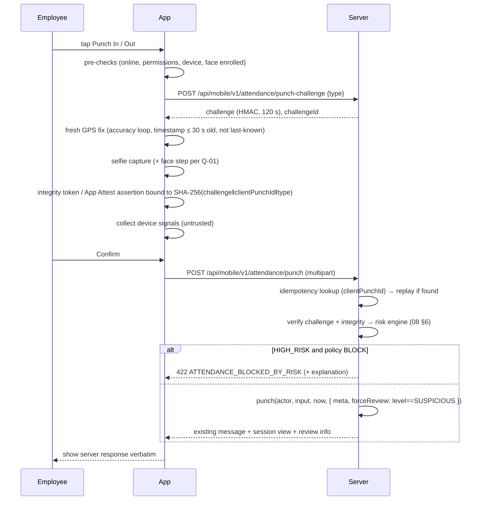

# 04 — Attendance Design (PROPOSED)

Server rules described here are the **existing** behaviour of `punch()` (`fashion-erp/src/modules/hrms/attendance-punch.service.ts:26`) and `evaluateGeofence()` (`fashion-erp/src/modules/hrms/attendance-calculator.ts:281`) unless marked **NEW**. The app never decides attendance; it collects inputs and shows the server's answer.

## 1. Principles

1. Reuse: today/month/day/remark through existing routes; punch through the existing `punch()` service. No second attendance engine, no new attendance tables, no client-side geofence decision.
2. Server time only. Online only (D-008). Foreground location only (D-009).
3. Existing company policy is preserved: `AttendanceLocation.radiusMeters` (default 100), `AttendanceSettings.gpsAccuracyMeters` (default 50), `requireFace`. Nothing is silently relaxed.
4. Client-reported values are inputs, not proof (SW-2). Anti-fraud is in `08` §4–6.

## 2. Attendance Dashboard

| Field | Source |
|---|---|
| Employee name, Employee ID (`employeeCode`) | `GET /api/v1/attendance/me/today` → `employee` |
| Company name | `GET /api/mobile/v1/me` → `company.name` |
| Today's status (not in / in since / out at) | `isPunchedIn`, `sessions[]` |
| Check-in / check-out times | `sessions[].checkInAt/checkOutAt` |
| Working hours | `finalizedHours` + `liveHours` (app ticks locally from the open session's `checkInAt`, resyncs on refetch) |
| Current GPS status, accuracy | live from `location.ts` while the dashboard is focused (started on focus, stopped on blur or after a good fix; no background) |
| Office distance (estimate) | `estimate.ts` Haversine from the live fix to `GET /api/mobile/v1/attendance/locations`; labelled "estimate" |
| Attendance eligibility | client pre-check summary: online, permission, precise location, fix fresh and within `rules.gpsAccuracyMeters`, face enrolled if `requireFace`, device ACTIVE, `permissions.attendance.punch`. **Final decision is the server's.** |
| Shift | `employee.shift` (name, start–end, grace) |
| Warning | open session from an earlier day ("You didn't punch out on …") |

## 3. Check-in and check-out flow

Check-out follows exactly the existing OUT rules: requires an open `SELF_PUNCH` session; `now` must be after check-in; guarded update; an outside OUT also marks the session `PRESENT_FROM_OUTSIDE`. A fresh location and selfie are required for OUT, like the web.

## 4. Location handling

| Situation | Detection (app) | Behaviour |
|---|---|---|
| Permission not yet asked | `getForegroundPermissionsAsync` | Location Permission screen (explainer) → OS prompt |
| Denied | status `denied` / `canAskAgain=false` | explain + "Open Settings"; punch disabled |
| Services off | `hasServicesEnabledAsync()` false | Android: system enable dialog (`enableNetworkProviderAsync`); iOS: instructions |
| Approximate only | Android 12+ coarse grant; iOS precise toggle off (accuracy authorization reduced) | ask for **Precise**; punch disabled until granted |
| Weak GPS | accuracy > `rules.gpsAccuracyMeters` after 30 s | GPS Verification screen with live ± m, tips, Try again |
| GPS unavailable | error / no fix in 30 s | same screen, "No GPS signal" |
| Cached location | never use `getLastKnownPositionAsync` for punching; reject fixes with `timestamp` older than 30 s | re-acquire |
| Stale coordinates | fix older than 60 s at Confirm | re-acquire before submit; server also checks challenge age (≤ 120 s) and reported fix age (NEW, signal) |
| Network failure | NetInfo / fetch error | "No internet"; nothing queued; retry keeps `clientPunchId` |

Location request: `watchPositionAsync({ accuracy: BestForNavigation, timeInterval: 1000, distanceInterval: 0 })`; stop at the first fix within the limit; hard stop after 30 s.

## 5. Geofence (server, existing)

- All **active** `AttendanceLocation`s of the company are checked; inside if Haversine distance ≤ `effectiveRadius()` = max(10, `radiusMeters`) (default 100 m); nearest inside wins, else nearest overall with its distance.
- Multiple offices are supported today (one row each). **Employee-to-office assignment does not exist** — any employee can be "inside" at any active company location (Q-19).
- Outside → recorded as `PRESENT_FROM_OUTSIDE` → existing outdoor approval (`hrms_attendance_outdoor`: approve → `REMOTE`; reject → `OutdoorRejection` with trimmed times; employee can clarify).
- The app's distance is only an estimate with the same formula; it never decides.
- The radius is **not** changed by this project.

## 6. Factory floors: the 200–225 m problem

Observed: from different factory floors the web app has shown ~200–225 m apparent distance from the office point, while the radius is ~100 m.

Facts that matter:
- Reported `accuracy` is a statistical estimate (≈ one standard deviation); indoors under concrete/metal, multipath errors can exceed the reported accuracy. A fix can claim ± 30 m and be 200 m off.
- Native APIs (Android fused provider with Wi-Fi scanning, iOS Core Location) **may** do better than the browser, but this is not guaranteed — it must be measured.
- Because `punch()` rejects `accuracy > gpsAccuracyMeters` outright (punch **not recorded**), a genuine employee indoors can be blocked; if accuracy passes but the position is wrong, the punch is recorded as outside and goes to review.

**Required before any threshold decision (Phase 0, Spike C — field test):**
1. Survey the true coordinates of each building/floor entrance; check the configured office point is correct.
2. On each floor, with at least one low-end Android, one mid Android, one iPhone, and the current web flow: 20 fixes each; record reported accuracy, computed distance, time-to-fix, Wi-Fi on/off.
3. Compare with the configured radius/accuracy; report to the user.

**Fallback options for genuine employees (need approval, Q-13):**

| Option | Change type | Notes |
|---|---|---|
| a. Correct office coordinates / add one `AttendanceLocation` per building block | configuration (existing feature) | no code; not a radius increase |
| b. Keep reject + use existing regularization (attendance correction) on the web | none | slow for employees; regularization is not in mobile v1 |
| c. Accept low-accuracy punches as SUSPICIOUS → outdoor review instead of rejecting | **changes the existing accuracy rule** (minimum modification in `punch()` via an option, mobile channel only) | keeps employees unblocked, HR reviews |
| d. Per-location accuracy limit | schema + rule change | more complex |
| e. Wi-Fi BSSID / BLE beacon presence | future | iOS needs a special entitlement for Wi-Fi info; out of v1 |

Recommendation: a first; then c if the field test shows genuine employees still failing. Nothing changes without approval.

## 7. Face verification

> **Decided 2026-11-03 (D-012, user): same as the web app.** On-device match against the employee's enrolled photos with the company `faceMatchThreshold` / `faceMatchFrames`, then `facePhotoId` is sent with the punch and the server keeps its existing ownership check. No server-side matching, no new setting. Known weakness SW-1 accepted; managers can still review selfies. The options below are kept for history.

Existing web model: browser match → `facePhotoId` sent → server only checks ownership (SW-1). Server rejects punches without `facePhotoId` when `requireFace = true` (the default).

Consequences for mobile:
- If a company keeps `requireFace = true`, the mobile app **cannot punch at all** unless it sends a `facePhotoId` — which means implementing some face step.
- The user's rule: do not make face verification mandatory on mobile without explicit approval, and do not copy the client-trust model blindly.

Options (analysis in `08` §7): A. selfie-only on mobile (company opts in through a new `requireFaceOnMobile` setting, managers review selfies); B. on-device match (same trust weakness as web, slightly better UX); C. server-side match with liveness (real assurance, cost/complexity). **Open — Q-01 / D-012. Phase 5 cannot start until decided.**

## 8. Duplicates, retries and idempotency

| Case | Handling |
|---|---|
| Double tap | Confirm button disabled while submitting |
| IN while open / OUT without open | existing `409 INVALID_STATE_TRANSITION` messages |
| Response lost after the server saved the punch | retry with the same `clientPunchId` → server finds it in `hrms_attendance_punch_meta` → returns the stored response with `replayed: true` (no misleading error) |
| Retry after the challenge expired | idempotency lookup happens **before** challenge checks; if not saved, app fetches a new challenge + fresh fix and resends with the same `clientPunchId` |
| Concurrent duplicates | unique `(company_id, client_punch_id)` → P2002 → replay path |
| Challenge reused for a different punch | unique `challenge_id` → `409 CHALLENGE_INVALID` |

## 9. Shift rules

Unchanged: punch is not blocked by shift times; lateness (`computeIsLateIst()`, `graceMinutes`) shows in the month report (`isLate`). The app shows the shift and the Late tag only.

## 10. History

- Month: `GET /api/v1/attendance/me/month?month=YYYY-MM` (existing).
- Day: `GET /api/v1/attendance/me/day?date=…` (existing) + selfies via `GET /api/v1/attendance/sessions/{id}/selfie/{in|out}`.
- Remark: `PUT /api/v1/attendance/me/remark` (existing rules).
- Risk/review state of a punch (NEW, optional): shown as "Under review" when the session is `PRESENT_FROM_OUTSIDE`; the existing response already carries `status`.

## 11. Android vs iOS

| Topic | Android | iOS |
|---|---|---|
| Permission | FINE + COARSE; user may choose Approximate (12+) | While Using / Allow Once; Precise toggle (14+) |
| Background | `ACCESS_BACKGROUND_LOCATION` never declared | no "Always" purpose string |
| Enable GPS | system dialog possible | instructions only |
| Mock signal per fix | `Location.isMock()` (API 31+) / `isFromMockProvider()` (18–30); exposed by `expo-location` as `mocked` | `CLLocation.sourceInformation.isSimulatedBySoftware` (iOS 15+); also exposed by `expo-location` as `mocked` (software-simulated; per Expo docs, D-034) |
| Integrity | Play Integrity | App Attest |
| First fix | depends on Google Play services | usually fast |

## 12. Out of scope (v1)

Leave, regularization, outdoor clarification from the phone, overtime, team views, maps, kiosk/shared-device mode, offline punches.
