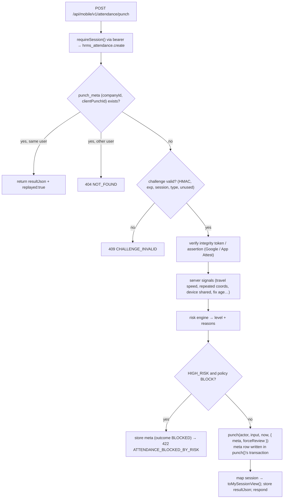

# 06 — Database and Backend Changes (PROPOSED — nothing applied)

Every item needs approval. All schema changes are **additive** (new tables/enums/columns with defaults). No attendance or employee table is duplicated; no existing column is renamed or removed. Migrations follow `fashion-erp/CLAUDE.md` ("Environment & gotchas": `prisma migrate diff` → `prisma db execute` → `prisma migrate resolve`), each with `fashion-erp/prisma/rollback/*.down.sql`.

## 1. Change list (with reasons)

| Id | Change | Reason | Phase |
|---|---|---|---|
| B-01 | table `mobile_sessions` | bearer tokens must be revocable per device; NextAuth JWT cookie is stateless (no row to revoke) | 1 |
| B-02 | table `mobile_devices` | device registration, revocation, device policy, App Attest public key + counter, integrity status (D-024) | 1 (row) / 4 (integrity fields used) |
| B-03 | module `fashion-erp/src/modules/mobile-auth/` (token generate/hash/rotate/revoke, device policy, login/refresh/logout services, schema, repository) | adapter logic in one place | 1 |
| B-04 | bearer adapter in `requireSession()` + extracted shared live checks + bearer route **allowlist** in `fashion-erp/src/proxy.ts` | reuse existing routes without a second auth system (D-003, D-006) | 1 |
| B-05 | new routes `fashion-erp/src/app/api/mobile/v1/**`: `app-config`, `auth/login`, `auth/refresh`, `auth/logout`, `auth/logout-all`, `me`, `devices`, `devices/[id]`, `devices/register`, `attendance/punch-challenge`, `attendance/locations`, `attendance/punch` | functions with no existing equivalent (`01` §6) | 1, 4, 5 |
| B-06 | table `hrms_attendance_punch_meta` | idempotent replay, challenge single-use, channel/device, verified integrity summary, raw client signals, risk level + reasons — without touching `hrms_attendance_sessions` | 5 |
| B-07 | stateless HMAC punch challenge (no table) + env secret `MOBILE_CHALLENGE_SECRET` | replay prevention with minimum storage (single use enforced by the unique `challenge_id` in B-06 / device row for registration) | 4 |
| B-08 | integrity verifiers: Play Integrity token decode (server → Google API with a service account) and App Attest attestation/assertion verification (CBOR + X.509 chain to Apple's App Attest root, nonce, `rpIdHash`, counter) | client results can't be trusted without server-side cryptographic verification | 4 |
| B-09 | risk engine `fashion-erp/src/modules/mobile-attendance/risk-engine.ts` + additive policy columns on `AttendanceSettings` | explainable, configurable outcomes (D-011) | 6 |
| B-10 | new `BusinessRuleErrorCode`s: `INVALID_LOGIN` 401, `AUTH_TOKEN_EXPIRED` 401, `AUTH_TOKEN_INVALID` 401, `AUTH_SESSION_REVOKED` 401, `DEVICE_NOT_ALLOWED` 403, `CHALLENGE_INVALID` 409, `ATTENDANCE_BLOCKED_BY_RISK` 422, `APP_VERSION_UNSUPPORTED` 426 | app must distinguish these cases; closed code set lives in `fashion-erp/src/core/errors/BusinessRuleError.ts` | 1, 4, 6 |
| B-11 | per-IP rate limit for login/refresh (existing per-email lockout stays) | SW-3 | 1 |
| B-12 | audit entries (`writeAuditLog`) for login, refresh reuse, logout(-all), device register/revoke, punch risk outcome | `fashion-erp/CLAUDE.md` audit rule | 1–6 |
| B-13 | revoke mobile sessions/devices in `resetUserPassword()` and `setUserStatus()` (`fashion-erp/src/modules/administration/user-admin.service.ts:373`, `:333`) | clean state; live checks already block | 1 |
| B-14 | cleanup job (BullMQ) for expired/revoked sessions > 90 days | table hygiene | 7 |
| B-15 | env vars (`10` §2) | configuration | 1 |
| B-16 | ~~root tooling excludes~~ — **dropped 2026-11-03**: app moved to its own repository (D-002 APPROVED), nothing to exclude in `fashion-erp` | — | — |
| B-17 | web Outdoor screen shows risk reasons for mobile punches (read from B-06) | reviewers must see *why* a punch was flagged | 6 |
| B-18 | **Server-side face verification (D-037, APPROVED):** (a) new additive table/columns to store each enrolled photo's face descriptor, computed once on enrolment (and back-filled for existing photos); (b) a face-verify service using the existing `@vladmandic/face-api` Node wasm build + `sharp` to decode the selfie; (c) `punch()` gets the server match result — no match / no face → session recorded with review status (same review queue as outside punches) and reason `FACE_NOT_MATCHED`; (d) web punch gets the same check; (e) new root dependencies `@tensorflow/tfjs@4.22.0` + `@tensorflow/tfjs-backend-wasm@4.22.0` (approval with D-037). Liveness not included | SW-1 (client-trusted face match) | before mobile go-live; accuracy test first |
| B-19 | `punch()` gets one optional trailing `options` param: `{ meta?, forceReview? }`, used inside its existing `$transaction`; web calls unchanged | write metadata atomically; route SUSPICIOUS punches to review | 5 |
| B-20 | (optional) web Admin: list/revoke a user's mobile devices; approve pending devices | HR device control | 7 |
| B-21 | (conditional) `AttendanceSettings.requireFaceOnMobile` | only if Q-01 picks "selfie-only on mobile" | 5 |
| B-22 | ~~DROPPED 2026-11-03 (CR-002: voice only where the backend already supports it)~~ Voice-note attachment targets for production progress entries / hand-backs, attendance day remark, leave requests, attendance corrections, outdoor clarification, approval remarks (CR-001, gap G-14) — add entries to `src/core/attachments/attachment-targets.ts` with each record's own scope rule; payment requests already supported | users who cannot type (user request) | 3–5 |
| B-23 | **Role permission changes (user-approved D-D04, D-D06):** add `payment_requests` view/create to PRODUCTION_WORKER, PRODUCTION_SUPERVISOR, WAREHOUSE_USER; add the `HRMS_TEAM_APPROVER` set (team attendance/records/photos view, regularization + leave + outdoor + overtime approve/reject) to PRODUCTION_SUPERVISOR. Change `ROLE_PERMISSIONS` in `fashion-erp/src/config/rbac.ts` for new companies **and** update existing companies' system roles in the DB through the existing role-permission service (never `prisma db seed`); call `PermissionService.invalidate()`. Roles are customizable per company, so companies that edited these roles must be reviewed, not overwritten | user decisions | before the release that uses them (expense: release 2; supervisor HR: release 2) |
| B-24 | One pointer line in `fashion-erp/AGENTS.md` and `GEMINI.md`: "For mobile-app work, follow `fashion-erp-mobile/docs/13_AI_AGENT_WORKFLOW.md` (approval gates)" (Q-17) | agent-instruction conflict | Phase 1 start |
| B-25 | (proposed, D-038) `app-config` per platform: `android.minAppVersion/latestAppVersion`, `ios.minAppVersion/latestAppVersion`, `storeUrl`, short `releaseNotes`, from env/settings. Phase 1 already returns one `minAppVersion` / `latestAppVersion` for both platforms | in-app update (CR-003) | Phase 2 |

## 2. `mobile_sessions` (B-01)

```prisma
enum MobileSessionRevokeReason { LOGOUT LOGOUT_ALL REPLACED_BY_NEW_LOGIN PASSWORD_CHANGED ADMIN_RESET USER_SUSPENDED DEVICE_REVOKED REFRESH_REUSE EXPIRED }

model MobileSession {
  id                        String    @id @default(uuid()) @db.Uuid
  companyId                 String    @map("company_id") @db.Uuid
  userId                    String    @map("user_id") @db.Uuid
  deviceId                  String    @map("device_id") @db.Uuid          // mobile_devices.id
  accessTokenHash           String    @unique @map("access_token_hash")
  accessTokenExpiresAt      DateTime  @map("access_token_expires_at")
  refreshTokenHash          String    @unique @map("refresh_token_hash")
  previousRefreshTokenHash  String?   @unique @map("previous_refresh_token_hash")
  previousRefreshValidUntil DateTime? @map("previous_refresh_valid_until")
  refreshTokenExpiresAt     DateTime  @map("refresh_token_expires_at")    // idle
  absoluteExpiresAt         DateTime  @map("absolute_expires_at")
  issuedAt                  DateTime  @default(now()) @map("issued_at")  // compared with User.passwordChangedAt
  lastUsedAt                DateTime? @map("last_used_at")               // throttled writes
  lastIp                    String?   @map("last_ip")
  appVersion                String?   @map("app_version")
  revokedAt                 DateTime? @map("revoked_at")
  revokeReason              MobileSessionRevokeReason? @map("revoke_reason")
  createdAt                 DateTime  @default(now()) @map("created_at")
  updatedAt                 DateTime  @updatedAt @map("updated_at")
  @@index([userId, revokedAt])
  @@index([deviceId])
  @@map("mobile_sessions")
}
```
Partial unique index (raw SQL): one active session per device `(device_id) WHERE revoked_at IS NULL`.

## 3. `mobile_devices` (B-02)

```prisma
enum MobileDeviceStatus { ACTIVE PENDING_APPROVAL REVOKED }
enum MobileIntegrityStatus { UNVERIFIED VERIFIED FAILED UNAVAILABLE }

model MobileDevice {
  id                   String                @id @default(uuid()) @db.Uuid
  companyId            String                @map("company_id") @db.Uuid
  userId               String                @map("user_id") @db.Uuid
  installationId       String                @map("installation_id")   // app-generated UUID; privacy-conscious
  platform             String                                            // android | ios
  model                String?
  osVersion            String?               @map("os_version")
  appVersion           String?               @map("app_version")
  ownership            String?                                           // optional label: COMPANY | PERSONAL (Q-16)
  status               MobileDeviceStatus    @default(ACTIVE)
  integrityStatus      MobileIntegrityStatus @default(UNVERIFIED) @map("integrity_status")
  integrityCheckedAt   DateTime?             @map("integrity_checked_at")
  integritySummary     Json?                 @map("integrity_summary")  // verdict fields only, no raw token
  iosAttestKeyId       String?               @unique @map("ios_attest_key_id")
  iosAttestPublicKey   String?               @map("ios_attest_public_key")  // PEM/SPKI from verified attestation
  iosAttestCounter     Int?                  @map("ios_attest_counter")     // monotonic, assertion replay guard
  firstSeenAt          DateTime              @default(now()) @map("first_seen_at")
  lastSeenAt           DateTime?             @map("last_seen_at")
  revokedAt            DateTime?             @map("revoked_at")
  revokedByUserId      String?               @map("revoked_by_user_id") @db.Uuid
  revokeReason         String?               @map("revoke_reason")
  @@unique([userId, installationId])
  @@index([companyId, status])
  @@index([installationId])            // "same phone used by another employee" signal
  @@map("mobile_devices")
}
```

## 4. `hrms_attendance_punch_meta` (B-06)

```prisma
enum AttendancePunchChannel { WEB MOBILE }
enum AttendancePunchSide { IN OUT }
enum AttendanceRiskLevel { NORMAL SUSPICIOUS HIGH_RISK }

model AttendancePunchMeta {
  id                String                 @id @default(uuid()) @db.Uuid
  companyId         String                 @map("company_id") @db.Uuid
  sessionId         String?                @map("session_id") @db.Uuid   // null when blocked (no session created)
  employeeId        String                 @map("employee_id") @db.Uuid
  side              AttendancePunchSide
  channel           AttendancePunchChannel
  clientPunchId     String                 @map("client_punch_id") @db.Uuid
  challengeId       String                 @unique @map("challenge_id") @db.Uuid
  mobileDeviceId    String?                @map("mobile_device_id") @db.Uuid
  appVersion        String?                @map("app_version")
  locationTimestamp DateTime?              @map("location_timestamp")    // client-reported
  serverReceivedAt  DateTime               @default(now()) @map("server_received_at")
  clientSignals     Json                   @map("client_signals")        // untrusted, as sent
  integrityResult   Json?                  @map("integrity_result")      // server-verified summary
  riskLevel         AttendanceRiskLevel    @map("risk_level")
  riskReasons       Json                   @map("risk_reasons")          // [{ code, strength, detail }]
  outcome           String                                                // ACCEPTED | SENT_TO_REVIEW | BLOCKED
  resultJson        Json?                  @map("result_json")           // response for idempotent replay
  createdAt         DateTime               @default(now()) @map("created_at")
  @@unique([companyId, clientPunchId])
  @@index([employeeId, createdAt])
  @@index([mobileDeviceId, createdAt])
  @@map("hrms_attendance_punch_meta")
}
```
Why: attendance tables stay untouched (`fashion-erp/docs/hrms/ATTENDANCE_MODULE_PLAN.md` §3 rule: new data in new `hrms_*` tables, existing tables additive only). Blocked attempts are stored too (no session) — needed for repeated-attempt and audit signals.

## 5. `AttendanceSettings` additive policy columns (B-09)

| Column | Default | Meaning |
|---|---|---|
| `mobile_suspicious_action` | `REVIEW` | `REVIEW` (force `PRESENT_FROM_OUTSIDE` → outdoor queue) or `ACCEPT_AND_LOG` |
| `mobile_high_risk_action` | `REVIEW` during pilot | `REVIEW` or `BLOCK` (Q-02) |
| `mobile_require_integrity` | `false` during pilot | if true, "integrity unavailable" counts as STRONG instead of WEAK |
| `mobile_signal_overrides` | `{}` (JSON) | per-signal strength overrides (e.g. downgrade `DEVELOPER_OPTIONS` to INFO) |
| `mobile_max_devices_per_user` | 2 | device policy (Q-16) |
| `mobile_new_device_requires_approval` | false | device policy (Q-16) |

## 6. Mobile punch wrapper (B-05 + B-19)



## 7. Not changed

NextAuth config and `/api/auth/*`; existing `/api/v1/*` responses; `punch()` validation order and messages; `evaluateGeofence()`; statuses and outdoor approval logic; salary calculator; `PermissionService` internals; RBAC catalogue (unless Q-10 asks for a mobile permission — then via `fashion-erp/scripts/sync-permission-catalog.mjs`).

## 8. New dependencies (need approval, Phase 4)

| Purpose | Likely need | Notes |
|---|---|---|
| Play Integrity decode | Google API auth (service-account JWT → `playintegrity.googleapis.com` `decodeIntegrityToken`) | could use `google-auth-library` or hand-rolled JWT with `node:crypto`; decide in Spike B |
| App Attest verification | CBOR decoder; X.509 verification via `node:crypto` `X509Certificate` | a maintained App Attest verification library may exist — UNKNOWN; evaluate in Spike B |

## 9. Volume

`mobile_devices` ≈ 1–2 per employee; `mobile_sessions` ≈ 1 active per device; `hrms_attendance_punch_meta` ≈ 2 per employee per working day (+ blocked attempts). All lookups by unique index.
