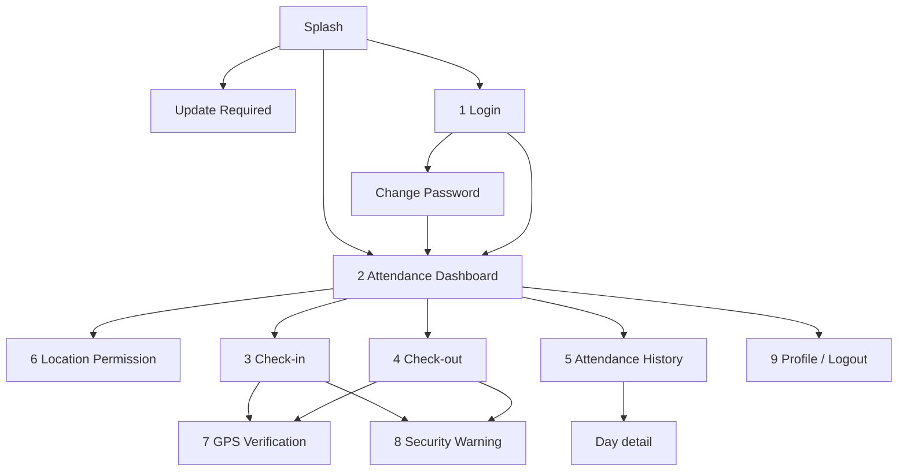

# 07 — UI / UX Specification (v1, PROPOSED)

Users: factory and office employees, often on budget Android phones, poor indoor GPS, patchy network, varied English. Goals: punch in under ~20 s when GPS is good, every failure explains the next step, no unnecessary screens.

## 1. Look and feel

- Follow the web ERP brand (`fashion-erp/DESIGN_SYSTEM.md`, `fashion-erp/UI_RULES.md`): same primary colour and status colours (green = present/inside, amber = review/outside, red = error/blocked, grey = weekend/holiday).
- Light theme first; tokens in `src/theme/`.
- Touch targets ≥ 48 dp; punch button full width ≥ 64 dp; text scales to 200 %.
- Strings in `src/config/strings.ts` (English; Hindi-ready, Q-11). Times IST, "9:42 AM", dates "Mon, 3 Nov".
- Lightweight: no map, no charts, no heavy animation.

## 2. Screens and navigation

Bottom tabs: **Today** (dashboard), **History**, **Profile**. Check-in/out, permission, GPS and security screens are full-screen steps over Today.

### 2.1 Login
Email (email keyboard, autofill), Password (show/hide), "Sign in". "Forgot password?" → sheet with the HR-reset text (`03` §4.6). Errors inline (server message), offline note, lockout/rate-limit text. Company is shown after login, never asked.

### Change Password (forced or voluntary)
Forced: title "Set your own password", no back button, Logout link. Fields current/new/confirm; live rules (≥ 8 chars, not the temporary password, different). On success: re-sign-in happens silently, toast "Password changed".

### 2.2 Attendance Dashboard
1. Header: employee name, Employee ID, company name, date.
2. Status card: "Not punched in" / "Punched in since 9:42 AM · 1 h 25 m" / "Punched out at 6:31 PM"; Inside/Outside/Under review tag with office name and distance (from the server's last punch).
3. Live check panel (while screen is visible): GPS status (Searching / Good / Weak / Off), accuracy "± 18 m (need ≤ 50 m)", estimated distance "≈ 40 m from Head Office", eligibility line ("Ready to punch" or the blocking reason).
4. Shift line.
5. Primary button **Check in** / **Check out**, disabled with reason when not eligible.
6. Warning banner for a forgotten punch-out.
7. Today's sessions list with selfie thumbnails.
8. "Add remark for today".
Pull-to-refresh; offline banner.

### 2.3 Check-in / 2.4 Check-out (same flow, different labels/colours)
Step 1 location (auto, uses GPS Verification when needed) → Step 2 selfie (front camera, oval guide; face step per Q-01) → Step 3 confirm (selfie, time "now", accuracy, inside/outside **estimate**) → submitting (spinner, button locked) → result: the server's message verbatim; if `review.needsReview`: amber "Recorded — sent to your manager for review"; if blocked: Security Warning screen. Check-out shows today's check-in time and hours so far on the confirm step.

### 2.5 Attendance History
Month header with ◀ ▶; summary chips (present, absent, leave, late, outside); day rows: date, code/band colour, first in – last out, hours, icons (late, outside/review, remark). Tap → Day detail: sessions, offices, distances, status, selfies, remark (edit if allowed).

### 2.6 Location Permission
Shown before the OS prompt and whenever permission is missing/denied/approximate. Text: "Fashion ERP uses your location **only while you check in or out**, to confirm you are at your office. It never tracks you in the background." Buttons: "Allow location" / "Open Settings" (when denied) / "Turn on Precise location" (when approximate) / "Turn on GPS" (services off).

### 2.7 GPS Verification
Live accuracy ring "± 85 m → need ≤ 50 m", elapsed timer (30 s), tips: "Move near a door or window", "Step outside the shed", "Turn on Wi-Fi (improves location)". Buttons "Try again", "Cancel". After repeated failure: "Still can't get a good signal? Ask HR to correct your attendance." (existing regularization on the web; Q-13 may add a review fallback).

### 2.8 Security Warning
Neutral, non-accusing. Cases: device revoked ("This phone is no longer allowed for attendance. Contact HR."), punch blocked by policy ("We couldn't verify this phone. Your punch was not recorded. Contact HR."), integrity unavailable on registration ("This phone couldn't be verified; your punches may be reviewed."), fake-location app detected (only when policy shows reasons — Q-20: "A location-changing app seems to be active. Turn it off and try again."). Never shows raw signal codes.

### 2.9 Profile / Logout
Name, email, phone, Employee ID, branch, department, designation, shift, company; device: model, "this phone", verification status; Change password; Sign out; Sign out of all devices; app version and server host.

### Update Required
"Please update the app to continue" → store link.

## 3. States

| Screen | Loading | Empty | Error |
|---|---|---|---|
| Dashboard | skeleton | "No punches yet today." | retry card with server message |
| History | skeleton rows | "No attendance this month." | retry |
| Day | skeleton | "No punches on this day." | retry |
| Profile | skeleton | — | retry |

## 4. Copy rules

Use the server's `message` when present (already user-friendly, e.g. "GPS accuracy is too low (85 m). It must be within 50 m — move to an open area and try again."). Never show codes/HTTP numbers. No words like "fraud", "spoof", "geofence" to employees — say "verify", "office area".

## 5. Accessibility

Screen-reader labels incl. disabled reasons; colour never the only signal; live hours announced at most once a minute; haptics on result.

## 6. Usability check (Phase 7)

5–8 employees (floor + office), two phone tiers: median punch time, first-punch success without help ≥ 90 %, permission flow completion.
