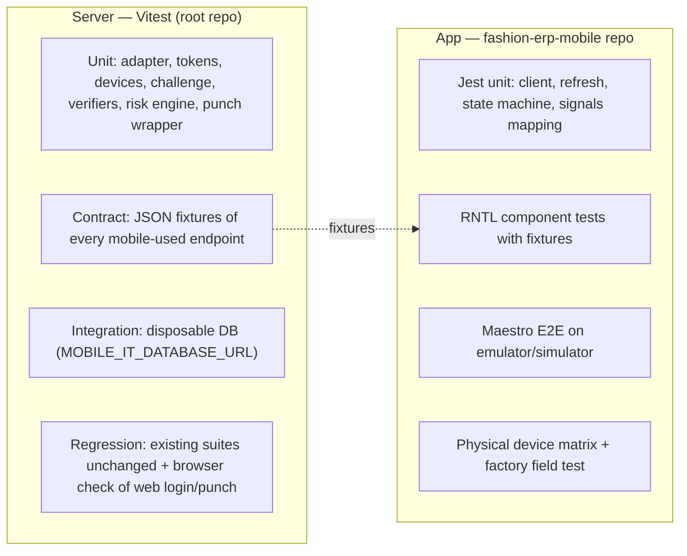

# 09 — Testing Strategy

**Rule:** a test is "passed" only after it has actually been executed, with the command/device and result recorded in the status handoff. Nothing in this document has been executed yet.

Server tests follow `fashion-erp/CLAUDE.md`: Vitest, mock repositories/`@/core/db/client` with `vi.mock` + `vi.hoisted`, dynamic import after mocks; integration tests only with an env var pointing at a disposable DB.

## 1. Authentication

| # | Case | Expected | Level |
|---|---|---|---|
| A1 | Valid login | token pair, user, company, `mustChangePassword=false`, device row | unit + integration + device |
| A2 | Invalid password | `401 INVALID_LOGIN`, generic text, failed attempt counted | unit |
| A3 | Account lockout | 6th attempt within 15 min refused; **same key as web** (web login also locked) | unit + manual |
| A4 | Deactivated user (`SUSPENDED`/`LOCKED`) | login `401 INVALID_LOGIN`; existing session → `403` "no longer active" | unit |
| A5 | Company inactive | login `401`; existing session → `403 ACCOUNT_SUSPENDED` | unit |
| A6 | Support proxy / platform user | cannot log in | unit |
| A7 | Temporary password | login ok with `mustChangePassword=true`; other routes `403 PASSWORD_CHANGE_REQUIRED`; `/me` + change-password allowed | unit + device |
| A8 | Access token expiry | `401 AUTH_TOKEN_EXPIRED` → app refreshes once, replays | unit (server + app) |
| A9 | Refresh rotation | new pair; old access invalid after rotation | unit |
| A10 | Refresh reuse within grace | accepted once | unit |
| A11 | Refresh reuse after grace | session revoked, `401 AUTH_SESSION_REVOKED`, audit row | unit + integration |
| A12 | Idle / absolute expiry | refused at 30 d idle / 90 d absolute (clock-mocked) | unit |
| A13 | Logout / logout-all | tokens dead; idempotent | unit |
| A14 | Password change on mobile | existing route ok → app re-login works; old session refused; other devices refused; web sessions refused | integration + device |
| A15 | Admin reset / suspend on web | next mobile call refused with matching message; rows revoked (B-13) | integration |
| A16 | Session revocation by device delete | device + sessions dead; `403 DEVICE_NOT_ALLOWED` on login from it | unit |
| A17 | Bearer token on non-allowlisted `/api/v1/*` route | `403` | unit (proxy) + integration |
| A18 | Web regression | `fashion-erp/src/lib/api-route.test.ts`, `authenticate.test.ts` pass **unchanged**; browser login works | regression |
| A19 | Old app version | `426 APP_VERSION_UNSUPPORTED` | unit |

## 2. Attendance

| # | Case | Expected |
|---|---|---|
| T1 | Valid check-in inside | session `PRESENT`, meta row NORMAL, response without storage keys |
| T2 | Valid check-out | session closed, existing hours logic; `onAttendanceDayChanged` fired |
| T3 | Duplicate check-in | existing `409` message |
| T4 | Duplicate check-out | existing `409` message |
| T5 | Network retry after success | same `clientPunchId` → `replayed:true`, one session |
| T6 | Concurrent duplicate requests | one session, other replayed |
| T7 | Retry after challenge expiry, punch never saved | new challenge + same `clientPunchId` → saved once |
| T8 | Challenge reused for another punch | `409 CHALLENGE_INVALID` |
| T9 | Stale GPS (fix > 60 s) | app re-acquires; server records `STALE_FIX` if sent |
| T10 | Weak GPS (> `gpsAccuracyMeters`) | existing `400` message; app GPS Verification screen |
| T11 | Outside office | `PRESENT_FROM_OUTSIDE`, appears in web Outdoor queue |
| T12 | Inside office (each configured location) | nearest inside chosen |
| T13 | **Different factory floors** | field test protocol §5; results reported, no threshold change without approval |
| T14 | Multiple office locations | evaluateGeofence picks nearest inside; app estimate matches server ± rounding |
| T15 | User not linked to employee | existing `400` message; dashboard shows reason |
| T16 | No `hrms_attendance.create` | `403`; punch button hidden/disabled |
| T17 | HRMS module off / subscription read-only | `403 MODULE_NOT_ENABLED` / `SUBSCRIPTION_READ_ONLY` |
| T18 | Same-day mix web + mobile | in on phone, out on web (and reverse) work |
| T19 | Mobile vs web data parity | today/month/day identical for the same user (contract test) |
| T20 | `requireFace=true` behaviour | per Q-01 decision |

## 3. Anti-fraud

| # | Case | Expected (defaults in `08` §6) |
|---|---|---|
| F1 | Android mock GPS app active | `mocked=true` → `MOCK_LOCATION_REPORTED` WEAK → SUSPICIOUS → review |
| F2 | Developer Options on, nothing else | WEAK → SUSPICIOUS (or NORMAL if overridden to INFO); **never blocked** |
| F3 | USB debugging on | as F2 |
| F4 | Wireless debugging on | as F2 if readable, else `null` recorded |
| F5 | Mock provider + Developer Options + USB debugging | 3 WEAK → SUSPICIOUS (not HIGH without a STRONG) |
| F6 | Rooted Android (Magisk) | Play Integrity lacks `MEETS_DEVICE_INTEGRITY` → STRONG → SUSPICIOUS; + mock (1 WEAK) → still SUSPICIOUS; + mock + root heuristic (2 WEAK) → HIGH_RISK |
| F7 | Emulator | device integrity fails → STRONG; heuristics WEAK → HIGH_RISK with ≥ 2 WEAK |
| F8 | Modified/repackaged APK | `UNRECOGNIZED_VERSION` (prod) → STRONG |
| F9 | Invalid / foreign Play Integrity token (wrong requestHash or package) | CRITICAL → HIGH_RISK |
| F10 | iOS App Attest assertion with bad signature / non-increasing counter | CRITICAL → HIGH_RISK |
| F11 | iOS device without App Attest support | `INTEGRITY_UNAVAILABLE` WEAK |
| F12 | Jailbreak indicators | WEAK |
| F13 | Replayed request (same body re-sent) | idempotent replay (no new punch) or `409 CHALLENGE_INVALID` |
| F14 | Invalid device registration (revoked / other user's installation) | `403 DEVICE_NOT_ALLOWED` |
| F15 | Suspicious location jump (Delhi → Mumbai in 1 h) | `IMPOSSIBLE_TRAVEL` STRONG |
| F16 | Same phone used by two employees same day | `DEVICE_SHARED_TODAY` STRONG for the second |
| F17 | Client sends all signals "false" but integrity fails | still STRONG/CRITICAL from server — client booleans can't clean a punch |
| F18 | HIGH_RISK with policy BLOCK | `422`, no session, meta `BLOCKED`, audit |
| F19 | Reviewer sees reasons in web Outdoor screen | B-17 |

## 4. Platform

| # | Case |
|---|---|
| P1 | Android versions: one each of 10/11, 12/13, 14/15, latest (approximate vs precise, `isMock` vs `isFromMockProvider`) |
| P2 | iOS versions: oldest supported by chosen Expo SDK, one middle, latest (Allow Once, Precise toggle) |
| P3 | GPS hardware: low-end Android, Samsung mid, Pixel, iPhone |
| P4 | Device without Google Play services (if any in fleet — UNKNOWN) |
| P5 | Factory indoor conditions (field test §5) |
| P6 | Network interruption at each step (challenge, upload, response) |
| P7 | Location permission denial, "don't ask again", approximate, services off |
| P8 | Camera permission denial |
| P9 | Battery: no location use outside punch/dashboard (OS location indicators); 10 punches cost < 1 % battery on mid device (target to measure) |
| P10 | Performance: cold start ≤ 3 s to dashboard (mid device), punch upload ≤ 5 s on 4G |

Tools: Jest (`jest-expo`) + React Native Testing Library; Maestro flows (login/logout, forced password change, punch in/out with emulator geo fix and a dev-only camera stub that is compiled out of release builds); Android emulator `geo fix` / mock apps; iOS simulator custom location (App Attest unsupported on simulator → physical iPhone required for F10/F11).

## 5. Factory field test protocol (Phase 0 Spike C, repeated in Phase 7)

For each building/floor: surveyed reference point; devices: low Android, mid Android, iPhone, web browser; Wi-Fi on and off; 20 fixes each, 1 per 10 s. Record: reported accuracy, distance to configured office point, distance to reference point, time-to-fix, punch outcome under current settings. Output: table per floor + recommendation (`04` §6 options). Sign-off: user + HR.

## 6. Regression gate (every backend phase)

`npx tsc --noEmit`, `npm run lint`, `npm test` (with `NODE_OPTIONS=--max-old-space-size=6144` if needed), integration tests when the env var is set, browser check: web login, web punch on `/attendance/my`, Outdoor queue.

## 7. Test data

Never re-run `prisma db seed` on the dev DB (`fashion-erp/CLAUDE.md`). Create a test company/employees via the web UI or a reviewed script; keep test credentials in a git-ignored local file, never in docs.
