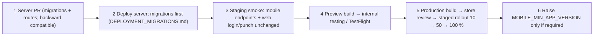

# 10 — Build and Deployment (PROPOSED)

## 1. Environments

| Env | Server | App | Notes |
|---|---|---|---|
| Local | `npm run dev`; phones reach `http://<LAN-IP>:3000` (`allowedDevOrigins` in `next.config.ts:37`) | Expo **development build** (not Expo Go — native integrity modules) with cleartext allowed in dev only | App Attest needs a physical iPhone; Play Integrity on dev builds returns `UNRECOGNIZED_VERSION` |
| Staging | staging ERP over HTTPS (host UNKNOWN, Q-09) | `preview` build via Play **internal testing** track (so Play Integrity recognises it) and TestFlight | anti-fraud testing must use these tracks |
| Production | `https://erp.indradhar.in/` (HTTPS/HSTS, nginx in front) | `production` build → Play / App Store or private distribution (Q-08) | staged rollout |

## 2. Server configuration (new env vars, B-15)

| Variable | Proposed default | Purpose |
|---|---|---|
| `MOBILE_ACCESS_TOKEN_TTL_SECONDS` | 900 | access token |
| `MOBILE_REFRESH_IDLE_DAYS` | 30 | sliding refresh |
| `MOBILE_REFRESH_ABSOLUTE_DAYS` | 90 | hard cap |
| `MOBILE_REFRESH_GRACE_SECONDS` | 30 | lost-response grace |
| `MOBILE_MIN_APP_VERSION` / `MOBILE_LATEST_APP_VERSION` | 1.0.0 | update gate |
| `MOBILE_CHALLENGE_SECRET` | (random, required) | HMAC for punch/registration challenges |
| `MOBILE_CHALLENGE_TTL_SECONDS` | 120 | challenge life |
| `PLAY_INTEGRITY_PACKAGE_NAME` | (bundle id) | expected package |
| `PLAY_INTEGRITY_SERVICE_ACCOUNT_JSON` (or path) | (secret) | decode tokens via Google |
| `APP_ATTEST_TEAM_ID`, `APP_ATTEST_BUNDLE_ID`, `APP_ATTEST_ENV` (`production`/`development`) | — | rpIdHash + aaguid check |
| `MOBILE_IT_DATABASE_URL` | unset | integration tests |

Secrets go in the deployment's secret store, never in git. Documented in `fashion-erp/docs/PLATFORM_SAAS_RUNBOOK.md` in Phase 1/4 (not now).

## 3. App configuration

`app.config.ts`: `EXPO_PUBLIC_API_BASE_URL` per profile (production `https://erp.indradhar.in`; staging UNKNOWN); `APP_VARIANT` (`development`/`preview`/`production`) → bundle id suffix and name so builds install side by side; privacy notice URL.

Identifiers (D-036, APPROVED): `in.indradhar.fashionerp`; variants `in.indradhar.fashionerp.dev`, `in.indradhar.fashionerp.preview`. The **App Attest rpId uses the exact Team ID + bundle id**; the **Play Integrity package name** must match — fix them before Phase 4.

Permissions:
- iOS: `NSLocationWhenInUseUsageDescription`, `NSCameraUsageDescription`, `NSMicrophoneUsageDescription` (voice notes, CR-001); App Attest entitlement (`com.apple.developer.devicecheck.appattest-environment`).
- Android: `ACCESS_FINE_LOCATION`, `ACCESS_COARSE_LOCATION`, `CAMERA`, `RECORD_AUDIO` (voice notes, CR-001), `INTERNET`. **Not**: `ACCESS_BACKGROUND_LOCATION`, `QUERY_ALL_PACKAGES`, storage. Check the merged manifest after every new module.

## 4. Accounts, setup and costs

| Item | Needed for | Cost (verify current) | Owner |
|---|---|---|---|
| Expo account (organisation) + EAS | builds, submit, updates | free tier; paid plans for more build minutes | UNKNOWN (Q-08) |
| Google Play Console developer account | distribution, Play Integrity | one-time registration fee | UNKNOWN |
| Google Cloud project linked in Play Console + service account | Play Integrity decode | API free within quota (request increase if needed) | UNKNOWN |
| Apple Developer Program (organisation) | distribution, App Attest, DeviceCheck | annual fee | UNKNOWN |
| Optional face-liveness vendor | only if chosen (Q-01) | per-check fees | — |

## 5. EAS

```json
{
  "build": {
    "development": { "developmentClient": true, "distribution": "internal", "env": { "APP_VARIANT": "development" } },
    "preview":     { "distribution": "store", "env": { "APP_VARIANT": "preview" } },
    "production":  { "autoIncrement": true, "env": { "APP_VARIANT": "production" } }
  },
  "submit": { "preview": {}, "production": {} }
}
```
`preview` is submitted to Play internal testing / TestFlight (needed for real integrity verdicts). Signing keys: EAS-managed; Android upload key backed up by the account owner; Play App Signing on. OTA (EAS Update) only for JS fixes within the same `runtimeVersion`, never for changes that need new server endpoints or native modules.

## 5a. In-app update (D-038, PROPOSED)

| Case | Trigger | Android | iPhone |
|---|---|---|---|
| Forced | installed < `minAppVersion` (app-config; server also answers 426) | AUTH-010 + Google Play in-app update **immediate** flow | AUTH-010 + open App Store page |
| Optional | installed < `latestAppVersion` | AUTH-012 sheet + Play in-app update **flexible** flow (downloads inside the app, "Restart to update") | AUTH-012 sheet → App Store page |
| Small JS fix | new EAS Update for the same `runtimeVersion` | downloaded silently, applied on next launch | same |

Notes: Play in-app updates work only for builds installed from Google Play (internal testing track counts). "Later" on an optional update is remembered for 24 h. Raise `MOBILE_MIN_APP_VERSION` only after the new version is live in both stores (§6).

## 6. Versioning and release order


Risk policy goes live in **monitor mode** first (HIGH_RISK → review, not block) for an agreed pilot period (Q-02).

Rollback: server per `fashion-erp/docs/PLATFORM_SAAS_RUNBOOK.md` with `fashion-erp/prisma/rollback/*.down.sql`; app by halting staged rollout or OTA to the previous JS bundle.

## 7. CI (optional, Phase 8)

Mobile lint/typecheck/Jest in CI (GitHub Actions or the existing `fashion-erp/Jenkinsfile` pipeline); builds on EAS.

## 8. Store checklist

Privacy policy URL; Play Data safety (precise location at punch time, photos/selfie, personal info, device identifiers = app-generated id; encrypted in transit; deletion path); Apple privacy details; App Review notes with a demo account and an explanation that outside punches are recorded for review; screenshots; foreground-only location statement.
