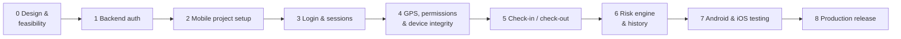

# 11 — Implementation Roadmap (Phases 0–8, PROPOSED)

Every phase ends at a **user review gate**. The next phase starts only after the gate is marked Approved in `14_MOBILE_PROJECT_STATUS.md`. Branch per phase: `phase-<n>-<slug>` from `main`; never pushed to `main` by an agent.

> **Revision 3 (2026-11-03) — role-based design brief.** The phase list is re-cut to the brief. Nothing below is approved; implementation of any screen needs its design approved first (`design/approvals/`).
>
> | New phase | Content | Detailed tasks (this document) |
> |---|---|---|
> | **0 Design & feasibility** | ERP audit, screen inventory, permission/API mapping, design system, mockups, clickable prototype, spikes A/B/C, approvals | Phase 0 below + `design/` |
> | **1 Backend authentication** | Mobile bearer adapter, tokens, refresh rotation, device registration, logout/revocation, `GET /me` with permission keys (gap G-01) | Phase 1 below |
> | **2 Mobile foundation** | Expo project, navigation, theme + shared components from the approved design system, API client, secure storage, errors, logging | Phase 2 below |
> | **3 Common employee features** | Login, profile, attendance (punch flow incl. GPS/integrity/risk), reports, expense request + status, notifications | old Phases 3–6 below |
> | **4 Worker & supervisor** | Assigned work, progress submission, hand back, approvals, team views where permitted | new — after design approval of 03/04 |
> | **5 Other authorized modules** | Production, inventory, purchase, sales/CRM, accounts, HRMS, dispatch — only screens whose design, APIs and permissions are approved; backend gaps decided first | new |
> | **6 Admin & owner dashboards** | Company overview, KPIs (needs numeric KPI API, G-03), approvals (G-04), reports | new |
> | **7 Security & testing** | Auth, permission, API, GPS, anti-fraud, Android/iOS, regression | old Phase 7 below |
> | **8 Builds & release** | APK/AAB, IPA, TestFlight, store submission | old Phase 8 below |
>
> The detailed sections below were written for the attendance-first plan; their tasks, acceptance criteria and checklists still apply to the matching new phases.

---

## Phase 0 — Documentation approval and technical feasibility

**Objectives:** user approves the docs and decisions; prove the risky parts are feasible before any production code.

**Tasks**
1. User review of docs 00–14; answers to blocking questions (`12`): Q-01, Q-02, Q-03, Q-04, Q-07, Q-08, Q-09, Q-10, Q-13, Q-16, Q-17, Q-18.
2. **Spike A — face verification:** server-side match feasibility on our Node server; on-device options; liveness vendors (cost/privacy). Report `docs/spikes/face-verification.md`.
3. **Spike B — integrity & device signals:** Play Integrity (standard request, server decode, quota), App Attest (register + assertion, server verification), iOS `isSimulatedBySoftware`, Android `Settings.Global` dev/ADB/wireless-ADB readability across Android versions, choose community wrapper vs custom Expo Module. Throwaway dev build on real devices. Report `docs/spikes/integrity.md`.
4. **Spike C — factory GPS field test** (`09` §5) including the 200–225 m floor issue; native vs browser. Report `docs/spikes/factory-gps.md`.
5. Confirm accounts/owners (Expo, Play Console, Google Cloud, Apple), bundle id and Team ID.

**Files expected to change:** `docs/**` only (spike reports, decisions, status). Spike code is throwaway and **not committed** to the repo.

**Dependencies:** none.

**Risks:** spikes need developer accounts and physical devices; Play Integrity needs the app on a Play test track; field test needs factory access.

**Acceptance criteria**
- All listed questions answered; affected decisions marked APPROVED or revised.
- Three spike reports with measured results and a recommendation each.
- User explicitly approves starting Phase 1.

**Tests:** spike measurements only (recorded with device/OS/version).

**Checklist**
- [ ] Docs approved
- [ ] Blocking questions answered
- [ ] Spike A / B / C reports
- [ ] Accounts and identifiers confirmed
- [ ] Status updated, gate approved

---

## Phase 1 — Backend authentication compatibility (in `fashion-erp`)

**Objectives:** mobile bearer authentication works through a thin adapter with the same rules as the web. (Root tooling isolation is no longer needed: the app lives in its own repository — D-002 APPROVED, B-16 dropped.)

**Tasks**
1. Work on a branch in `fashion-erp` (`mobile/phase-1-auth`); nothing in this phase touches the `fashion-erp-mobile` repo except the status/decision docs.
2. Migration: `mobile_sessions`, `mobile_devices` (+ enums, partial unique index, rollback SQL).
3. `fashion-erp/src/modules/mobile-auth/` (tokens, device policy, login/refresh/logout services, schema, repository).
4. Extract shared live checks; add bearer branch to `requireSession()`; bearer allowlist in `fashion-erp/src/proxy.ts` (confirm Next 16 header access in `node_modules/next/dist/docs/`).
5. Error codes `INVALID_LOGIN`, `AUTH_TOKEN_EXPIRED`, `AUTH_TOKEN_INVALID`, `AUTH_SESSION_REVOKED`, `DEVICE_NOT_ALLOWED`, `APP_VERSION_UNSUPPORTED`.
6. Routes: `app-config`, `auth/login`, `auth/refresh`, `auth/logout`, `auth/logout-all`, `me`, `devices`, `devices/[id]`.
7. Per-IP limit (B-11), audit (B-12), revoke on reset/suspend (B-13), env vars (B-15), `fashion-erp/docs/history/mobile.md`.

**Files expected to change:** `fashion-erp/prisma/schema.prisma`, `fashion-erp/prisma/migrations/<ts>_mobile_auth/migration.sql`, `fashion-erp/prisma/rollback/<ts>_mobile_auth.down.sql`, `fashion-erp/src/modules/mobile-auth/*`, `fashion-erp/src/lib/api-route.ts`, `fashion-erp/src/proxy.ts`, `fashion-erp/src/core/errors/BusinessRuleError.ts`, `fashion-erp/src/app/api/mobile/v1/{app-config,auth,me,devices}/**`, `fashion-erp/src/modules/administration/user-admin.service.ts`, `fashion-erp/docs/history/mobile.md`.

**Dependencies:** Phase 0 (Q-03, Q-04, Q-09, Q-10, Q-16, Q-18).

**Risks:** touching `requireSession()`/proxy (shared by ~all routes) — mitigated by extraction-only refactor, unchanged tests, browser regression; in-memory lockout on multi-instance (SW-3).

**Acceptance criteria**
- Web `tsc`/`lint`/`test` all green after the change (existing suites unchanged).
- `fashion-erp/src/lib/api-route.test.ts`, `authenticate.test.ts` pass **unchanged**; web login + web punch verified in the browser.
- Auth test cases A1–A19 (`09` §1) pass, executed and recorded.
- A bearer token works on allowlisted existing routes (e.g. `GET /api/v1/attendance/me/today`) and is refused on others.
- No raw token stored or logged.

**Tests:** unit + integration (`MOBILE_IT_DATABASE_URL`) + curl walkthrough attached to the PR.

**Checklist**
- [ ] Migration applied by repo procedure; confirmed by SQL
- [ ] `npx prisma generate`; dev server restarted
- [ ] A1–A19 executed
- [ ] Regression gate (`09` §6)
- [ ] `fashion-erp/docs/history/mobile.md`
- [ ] Gate approved

---

## Phase 2 — Mobile project setup

**Objectives:** runnable Expo app skeleton with config, theme, API client and secure token store; no business screens.

**Tasks:** create the Expo project at the root of the `fashion-erp-mobile` repo (TypeScript, expo-router; record SDK in D-023); `app.config.ts` variants, ids, permission strings; `eas.json`; theme/strings/components; `api/client.ts`, `api/types.ts`, `auth/tokenStore.ts`, `auth/session.ts` (single-flight refresh); NetInfo banner; `app-config` + Update Required; Jest/RNTL/ESLint/TS local config; empty local module folders for native modules.

**Files expected to change:** new files in the `fashion-erp-mobile` repo only.

**Dependencies:** Phase 1 (endpoints for app-config).

**Risks:** Expo SDK/package compatibility; Windows dev machine for iOS builds (EAS cloud builds needed).

**Acceptance criteria:** dev build runs on an Android emulator, a physical Android and a physical iPhone (EAS build); app-config fetched from the LAN dev server; refresh single-flight test passes; merged Android manifest has no background location / `QUERY_ALL_PACKAGES` / storage.

**Tests:** Jest unit tests for client, refresh, token store.

**Checklist:** [ ] project created [ ] variants install side by side [ ] unit tests [ ] manifest/Info.plist check [ ] gate approved

---

## Phase 3 — Login and secure session management

**Objectives:** login, forced/voluntary password change, profile, logout(-all), expiry and deactivation handling in the app.

**Tasks:** Login screen + forgot-password sheet; Change Password (uses existing `POST /api/v1/account/change-password`, then re-login); Profile; logout/logout-all; device list (own devices, revoke); global handlers for every code in `05` §1; installation id.

**Files expected to change:** `app/(auth)/*`, `app/(app)/profile.tsx`, `src/auth/*`, `src/device/installationId.ts`, `src/features/profile/*`.

**Dependencies:** Phases 1–2.

**Risks:** token storage edge cases (iOS Keychain after reinstall, Android backup) — tested explicitly.

**Acceptance criteria:** real ERP user signs in, company shown; temporary-password user forced to change then lands on dashboard placeholder; app restart keeps session; each expiry message in `03` §4.4 demonstrated on a device; tokens absent from AsyncStorage/logs.

**Tests:** RNTL component tests; Maestro `login_logout`, `forced_password_change`; auth cases re-run end-to-end on device.

**Checklist:** [ ] all §4.4 cases demonstrated [ ] tests executed [ ] gate approved

---

## Phase 4 — GPS, location permissions and device integrity

**Objectives:** reliable foreground location acquisition, all permission states, device registration with server-verified integrity.

**Tasks (app):** Location Permission screen; GPS Verification screen; `location.ts` (accuracy loop, freshness, `mocked`); dashboard live GPS panel + estimate from `/attendance/locations`; native modules for Play Integrity / App Attest / Android settings signals / iOS simulated-location (per Spike B); `devices/register` flow.
**Tasks (server):** `attendance/locations` route; HMAC challenge (`punch-challenge` with `REGISTER`/`PUNCH`); integrity verifiers (B-08); `devices/register`; `mobile_devices` integrity fields used; `CHALLENGE_INVALID` code; dependencies approved.

**Files expected to change:** `app/{permission,gps-check}.tsx`, `src/features/attendance/{location,estimate}.ts`, `modules/*`, `src/device/*`; `fashion-erp/src/modules/mobile-auth/integrity/*`, `fashion-erp/src/app/api/mobile/v1/{devices/register,attendance/locations,attendance/punch-challenge}/**`, `fashion-erp/package.json` (only if verifier deps approved).

**Dependencies:** Phase 3; Spike B; accounts (Play Console, Google Cloud, Apple).

**Risks:** native module maintenance; Play Integrity quota; App Attest unsupported devices; Android OEM differences in settings readability.

**Acceptance criteria:** every permission state in `04` §4 reachable and handled on Android and iOS; registration verified on a Play-internal-track Android build and a TestFlight iPhone; a tampered/sideloaded build shows `FAILED`/`UNRECOGNIZED`; no location access outside dashboard/punch screens (OS indicators).

**Tests:** P7, F9–F11, F14 executed; unit tests for verifiers with recorded real tokens/attestations (sanitised).

**Checklist:** [ ] permissions states [ ] Android integrity verified server-side [ ] iOS App Attest verified server-side [ ] signals module per Android version table [ ] gate approved

---

## Phase 5 — Attendance check-in and check-out

**Objectives:** end-to-end punch through the existing `punch()` with challenge, idempotency and metadata; face handling per Q-01.

**Tasks (server):** migration `hrms_attendance_punch_meta`; `punch()` `options` param (B-19); mobile punch route (idempotency → challenge → integrity → *record signals* → `punch()`), response via `toMySessionView()`; risk engine stub that always returns NORMAL-with-reasons-recorded (real rules in Phase 6); B-18/B-21 if chosen.
**Tasks (app):** Check-in / Check-out screens, selfie + resize, face step per Q-01, punch state machine, retry with same `clientPunchId`, result screen; dashboard/today data via existing `GET /api/v1/attendance/me/today`.

**Files expected to change:** `fashion-erp/prisma/schema.prisma`, migration + rollback, `fashion-erp/src/modules/hrms/attendance-punch.service.ts` (options param only), `fashion-erp/src/modules/mobile-attendance/*`, `fashion-erp/src/app/api/mobile/v1/attendance/punch/route.ts`; `app/(app)/{index,punch}.tsx`, `src/features/attendance/{punchMachine,camera,face}.ts`.

**Dependencies:** Phase 4; **Q-01 decided**.

**Risks:** changing `punch()` signature (mitigated: optional param, existing tests unchanged); `requireFace` conflict (Q-01); indoor GPS (Q-13).

**Acceptance criteria:** T1–T12, T14–T20 executed and passing; mobile punches look identical to web punches in web screens; retry produces exactly one session; existing `attendance-punch.service.test.ts` and `attendance.integration.test.ts` unchanged and green; web punch verified in browser. **Not released to employees until Phase 6 is done.**

**Tests:** `09` §2.

**Checklist:** [ ] migration [ ] idempotency proven [ ] web parity [ ] regression gate [ ] gate approved

---

## Phase 6 — Anti-fraud risk evaluation and attendance history

**Objectives:** real risk engine with company policy; reviewers see reasons; history screens.

**Tasks (server):** risk rules (`08` §6) with per-company overrides (B-09 columns + web settings fields); server signals (impossible travel, repeated coordinates, shared device, fix age, abnormal accuracy); outcomes (review via `forceReview`, block via 422); web Outdoor screen shows reasons (B-17); audit.
**Tasks (app):** Security Warning screen; review messages; History (existing `me/month`), Day detail (existing `me/day` + selfie route), remark (existing `me/remark`).

**Files expected to change:** `fashion-erp/src/modules/mobile-attendance/risk-engine.ts` (+ tests), `fashion-erp/src/modules/hrms/attendance-settings.{schema,service}.ts`, `fashion-erp/src/app/(dashboard)/attendance/settings/AttendanceSettingsClient.tsx`, `fashion-erp/src/app/(dashboard)/attendance/outdoor/*`, migration for settings columns; `app/(app)/{history,day/[date],security-warning}.tsx`.

**Dependencies:** Phase 5; Q-02, Q-20.

**Risks:** false positives sending many genuine punches to review — start in monitor mode; reviewer confusion (outdoor queue naming).

**Acceptance criteria:** F1–F19 executed with expected levels; policy changes take effect without deploy; reviewers see reasons; history matches web for 3 sample months; no BLOCK enabled unless the user approves.

**Tests:** `09` §3 + history parity.

**Checklist:** [ ] rules + overrides [ ] reviewer UI [ ] F-cases executed [ ] monitor mode configured [ ] gate approved

---

## Phase 7 — Android and iOS testing

**Objectives:** full device matrix, factory field test with the real app, usability, security hardening.

**Tasks:** `09` §4 platform matrix; field test (`09` §5) repeated with the app; usability (`07` §6); hardening (`08` §9); cleanup job (B-14); optional device admin (B-20); privacy texts; fix findings.

**Files expected to change:** fixes in this repo and the mobile backend files in `fashion-erp`; `fashion-erp/src/core/jobs/*` (cleanup).

**Dependencies:** Phase 6.

**Risks:** device availability; findings that need design changes (go back through the decision log).

**Acceptance criteria:** all P-cases executed; field results accepted by user + HR; no open P0/P1 defects; P2s accepted in writing; privacy notice approved.

**Tests:** everything in `09`, results recorded per device.

**Checklist:** [ ] matrix [ ] field test [ ] usability [ ] hardening [ ] gate approved

---

## Phase 8 — Production release

**Objectives:** ship safely.

**Tasks:** production server deploy + secrets; production builds; store listings, privacy forms, review notes; staged rollout; risk policy in monitor mode for the agreed pilot; HR runbook ("phone can't punch", "device change", "flagged punches"); final `fashion-erp/docs/history/mobile.md`.

**Files expected to change:** `app.config.ts` (version), store assets, deployment docs, `fashion-erp/docs/history/mobile.md`.

**Dependencies:** Phase 7; accounts (Q-08); privacy policy (Q-15).

**Risks:** store review of location/camera use; App Attest rate limits on mass first launch (stagger rollout); Play Integrity quota.

**Acceptance criteria:** approved in stores (or private distribution); staged rollout reaches 100 % without P0; punch success ratio and review rate monitored from `hrms_attendance_punch_meta`; HR runbook delivered.

**Tests:** production smoke test with a test employee; web regression.

**Checklist:** [ ] server deployed [ ] store approval [ ] rollout [ ] runbook [ ] status → Released
