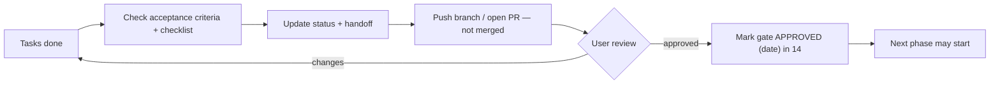

# 13 — AI Agent Workflow (Codex · Claude Code · Antigravity · others)

Applies to everything in the `fashion-erp-mobile` repository and every backend change made in `fashion-erp` for the mobile project.

## 1. Precedence and the known conflict

1. The user's direct instructions.
2. Approved mobile documentation — `12_DECISION_LOG.md` first, then the other files in `docs/`.
3. For backend work in the ERP repo: `fashion-erp/CLAUDE.md` (code rules: tenancy, permissions, errors, migrations, audit, tests).
4. `fashion-erp/AGENTS.md` (Codex) and `fashion-erp/GEMINI.md` (Antigravity/Gemini) — ERP repo only.

**Two repositories (D-002):** app + docs in `fashion-erp-mobile` (this repo, which has its own `CLAUDE.md`, `AGENTS.md`, `GEMINI.md` pointing here); backend changes in `fashion-erp`. A backend phase is a branch in `fashion-erp`; its status/handoff is still written in this repo's `docs/14_MOBILE_PROJECT_STATUS.md`.

**Known conflict (Q-17, partly resolved):** `fashion-erp/AGENTS.md` and `fashion-erp/GEMINI.md` say "never ask clarification questions" and "do not ask for confirmation or approval". This repo's own agent files follow the approval-gated process, so there is no conflict here. For backend phases inside `fashion-erp`, an agent that notices the conflict must **stop and report it**, not silently pick one side. Do not edit `fashion-erp/AGENTS.md`/`fashion-erp/GEMINI.md` without approval.

## 2. Before any work

- [ ] Read `14_MOBILE_PROJECT_STATUS.md` (phase, gate state, claimed tasks, last handoff).
- [ ] Read `12_DECISION_LOG.md`.
- [ ] Read the phase in `11_IMPLEMENTATION_ROADMAP.md` and the design docs for the area.
- [ ] Read `fashion-erp/CLAUDE.md` and the relevant `fashion-erp/docs/history/*.md` (`hrms.md` for attendance) for backend work.
- [ ] **Inspect the actual code** you will touch — docs can be stale; if they disagree with code, report it.
- [ ] **Verify previous agents' work from Git** (`git log`, `git diff`, run the tests they claim passed) before building on it.
- [ ] Confirm the previous phase gate is **Approved**. If not: stop and ask.

## 3. Rules

1. Do only the current phase's tasks; anything else → "Follow-ups" in the status file.
2. Never redesign approved architecture; propose a new decision row (PROPOSED) and ask.
3. Never expand scope (no future modules, no extra screens).
4. Never duplicate existing APIs or services; reuse per `01` §6 and `05`.
5. Never change web authentication beyond the approved adapter; never change attendance rules (accuracy, geofence, statuses, outdoor flow), the salary formula, or production configuration without approval.
6. Never treat a client-reported value as proof (D-027).
7. Never commit secrets (tokens, service-account JSON, keystores, `.env`, test passwords). Never log raw tokens or integrity tokens.
8. Write tests for every change; mark a test passed only after executing it, quoting the command and result.
9. Migrations: `fashion-erp/CLAUDE.md` procedure only; rollback SQL; never `prisma migrate dev`, never `prisma db seed` on the dev DB.
10. New dependencies: record in the decision log (D-031); root additions need approval.
11. Git: branch `phase-<n>-<slug>`; never push to `main`; never force-push shared branches; no bare `git stash` (shared across worktrees); never overwrite another agent's uncommitted or committed changes without inspecting them first.
12. Update `14_MOBILE_PROJECT_STATUS.md` at the end of each session and `12_DECISION_LOG.md` when a decision changes.
13. Report incomplete work honestly: what is not done, what failed, with output.
14. Docs in English; the user may write Hinglish.

## 4. Tool notes

| Agent | Reads automatically | Must also read |
|---|---|---|
| Claude Code | `fashion-erp/CLAUDE.md` | `docs/13`, `14`, `12` |
| Codex | `fashion-erp/AGENTS.md` | `fashion-erp/CLAUDE.md`, `docs/13`, `14`, `12` |
| Antigravity | `fashion-erp/GEMINI.md` | `fashion-erp/CLAUDE.md`, `docs/13`, `14`, `12` |
| Others | — | all of the above |

## 5. Claiming work

Add `🔄 <agent> — <date>` next to the task in the status file before starting; remove when done. Two agents never edit the same files at the same time. Backend (`fashion-erp/src/`, `fashion-erp/prisma/`) and app (`fashion-erp-mobile` repo) can proceed in parallel only where the roadmap allows.

## 6. Handoff format (append to `14`, newest first)

```markdown
### Handoff — <YYYY-MM-DD HH:mm IST> — <agent> — Phase <n>
**Branch / commit:** <branch> @ <sha> (PR: <link | none>)
**Goal:** <one line>
**Done:**
- <change> (`path`)
**Verified (executed):** <command → result>; <device/OS → result>
**Not done / failed:** <item — reason, output>
**Decisions proposed/changed:** <D-xxx | none>
**Questions for the user:** <Q-xx | none>
**Conflicts found:** <docs vs code, instruction conflicts | none>
**Next step:** <exact next task>
**Read first:** <files>
```

## 7. Phase gate



The agent stops at E. Merging is the user's decision.
